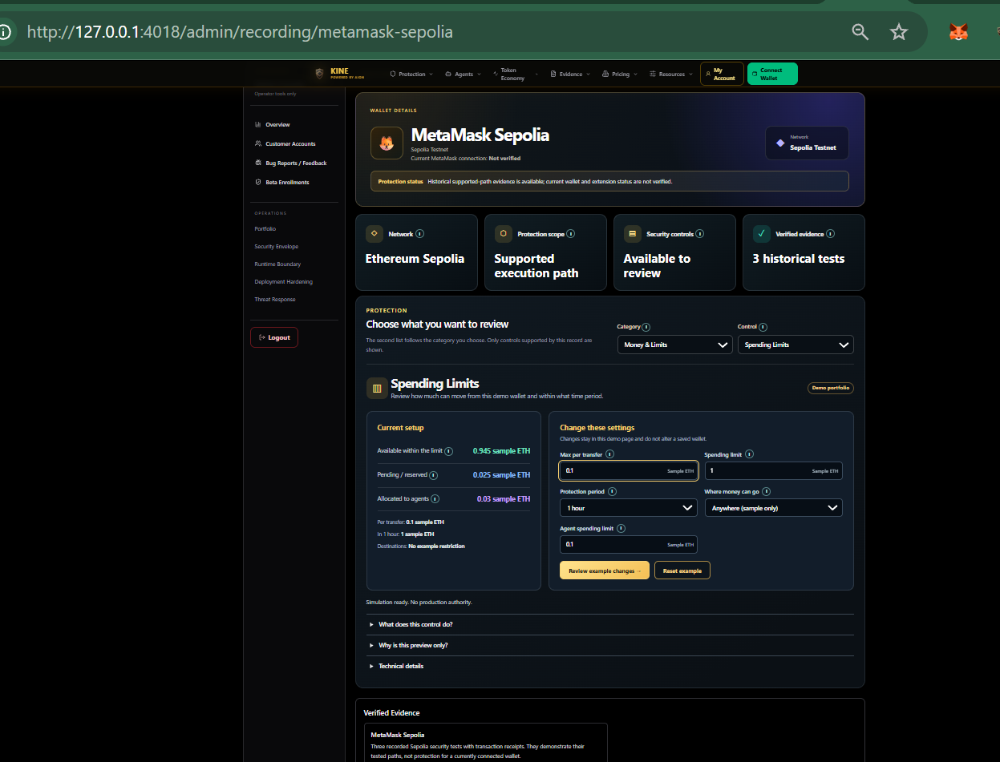
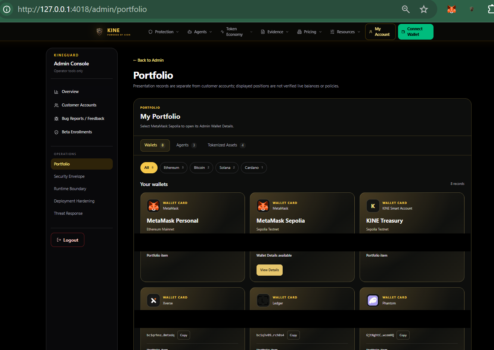
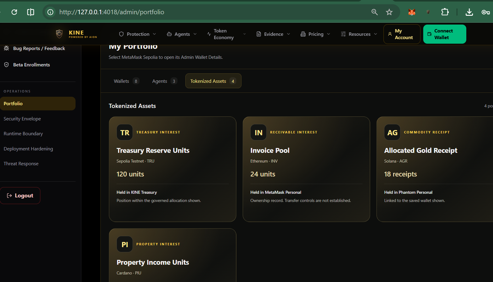
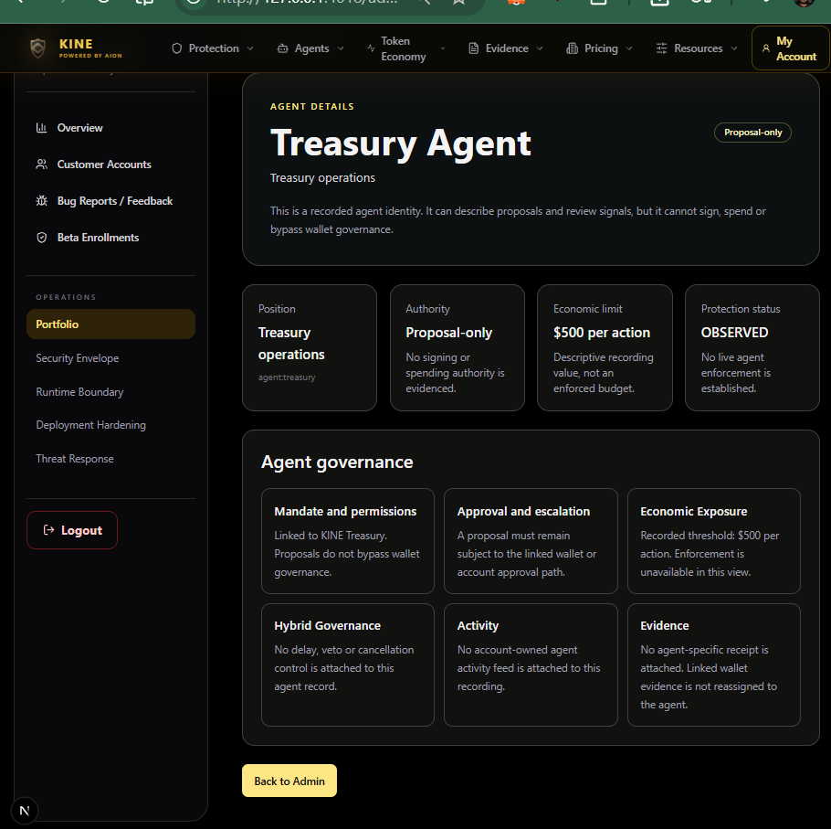
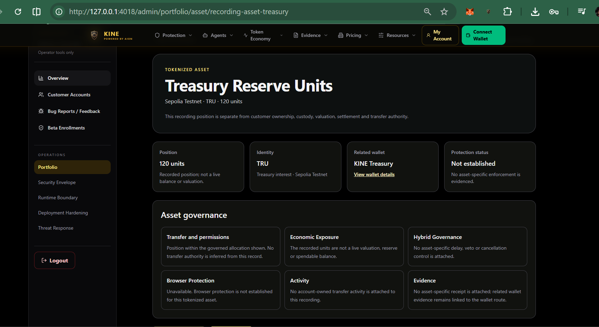
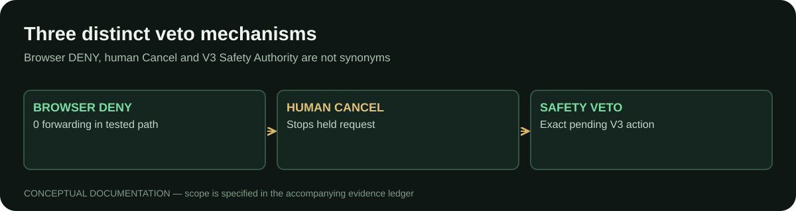
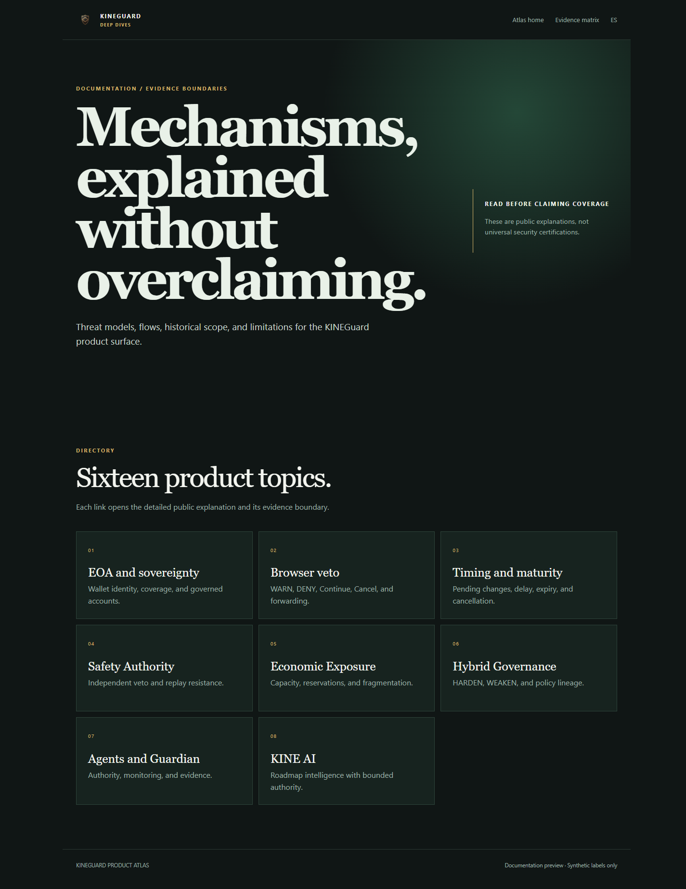
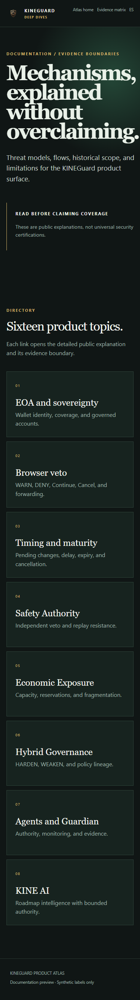
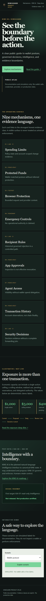

  

  # KINEGuard · KINE OS

  **KEY IS NOT ENOUGH**

  **Wallet security · Pre-execution decisions · Economic authority · Governed accounts · Forensic evidence**

  [**Arquitectura**](#arquitectura--architecture) · [**Pruebas**](#pruebas-históricas-verificadas-en-su-alcance) · [**Mecanismos**](#índice-completo-de-mecanismos) · [**Superficies públicas**](docs/en/public-surfaces.md) · [**English README**](README_EN.md)

> **Qué es este repositorio:** el atlas técnico y visual **nativo de GitHub** de KINEGuard/KINE OS. Incluye capturas reales del producto local controlado, material histórico, observación pública y límites explícitos. **No** es el runtime privado, un despliegue del producto ni una certificación de beta.

## Capturas reales del producto local

Estas nueve imágenes son capturas del KINEGuard local controlado, no del despliegue Hostinger. Sus estados, cifras y límites se conservan; los identificadores de wallet visibles fueron redactados para publicación. No prueban producción, enforcement universal ni transacciones on-chain.

| Superficie | Captura |
|---|---|
| Customer Spending Limits |  |
| Admin MetaMask / Sepolia |  |
| Wallet Portfolio |  |
| Tokenized assets |  |
| Treasury Agent |  |
| Agent Arena |  |
| Token Economy |  |
| KINE Lite wallet posture |  |
| Treasury reserve asset |  |

Source, redaction and classification are recorded in [the screenshot manifest](evidence/screenshot-manifest.md). The older Atlas screenshots remain historical documentation only and are not product proof.

## La tesis

Tener la llave privada o poder producir una firma válida **no equivale a autorización económica ilimitada**. KINE OS estudia cómo situar reglas deterministas entre una autoridad y las acciones que intenta ejecutar. La cobertura depende del tipo de wallet, la ruta de ejecución, el contrato gobernado, la política aplicable y la evidencia disponible.

- **KINEGuard** es la experiencia de cuenta, cartera, controles, Guardian, decisiones y evidencia.
- **KINE OS** es el plano de gobierno: autoridad, política, Economic Exposure, cambio de reglas, ejecución y recibos.
- **Browser Protection** puede retener solicitudes **soportadas** antes del proveedor. Una EOA puede operar por fuera de esa ruta.
- **KINE V2/V3** estudia cuentas cuyos fondos y acciones están sujetos a políticas contractuales. Las pruebas físicas históricas V3 fueron de **ETH nativo en Sepolia**.
- **KINE AI Intelligence** es una interfaz de inteligencia **propuesta para etapas posteriores**. La IA no firma, veta ni sustituye el motor determinista.

**Leitmotiv:** *AI understands. KINE governs. Humans retain control.*

## Arquitectura / Architecture

**Tres estados que no se pueden confundir:**

| Estado de cartera | Significado | No demuestra |
|---|---|---|
| **OBSERVED** | Hay identidad/saldo/observaciones leíbles | Que la EOA esté protegida o se pueda vetar toda firma |
| **PRE-EXECUTION COVERED** | Una solicitud específica entra en una ruta de navegador soportada y evaluada | Que las rutas alternativas de la EOA estén bloqueadas |
| **KINE GOVERNED** | Una cuenta/acción reside en una ruta de gobernanza contractual verificada para ese alcance | Cobertura global de tokens, cadenas o contratos no ensayados |

Más: [límites de cobertura](docs/deep-dives/01-wallet-and-sovereignty.md) · [arquitectura de ejecución](docs/architecture.md).

## Pruebas históricas verificadas en su alcance

| Serie | Experimento | Resultado preservado | Límite |
|---|---|---|---|
| **GP1A T1** | Safe zero-value held → Continue | MetaMask se abrió | No se confirmó transacción on-chain |
| **GP1A T2** | Held → Cancel | MetaMask no se abrió | Solo ruta soportada Chrome/MetaMask/Sepolia |
| **GP1A T3** | Unknown calldata → WARN → Cancel | MetaMask no se abrió | No abarca todos los calldata/proveedores |
| **GP1A T4** | Suspicious approval → BLOCK | MetaMask no se abrió | No es veto universal de la EOA |
| **V3 3B-1** | Transferencia pequeña bajo política | Se permitió la transferencia gobernada | ETH nativo Sepolia |
| **V3 3B-2** | Acción de mayor valor | Entró en pending; owner key no ejecutó anticipadamente | Acción gobernada exacta |
| **V3 3B-3** | Safety Authority independiente | Vetó la acción pendiente exacta | Veto on-chain, no browser Cancel |
| **V3 3B-4** | Acción legítima después del plazo | Maduró y se ejecutó en el experimento | No equivale a despliegue productivo |

El cierre de esas series es histórico; este repositorio **no repite transacciones, no mueve fondos y no transfiere automáticamente los resultados a mainnet, ERC-20 u otras rutas**. [Libro de pruebas, alcance y trazabilidad](docs/evidence-and-proofs.md).

## Veto, timing y autoridad separada

1. **Browser DENY:** para una solicitud cubierta y retenida, el evaluador evita el forwarding al proveedor.
2. **Human Cancel:** el usuario cancela la solicitud exacta retenida, también antes del proveedor.
3. **Safety Authority veto:** una autoridad distinta al owner veta una **acción ya pendiente dentro de la cuenta KINE gobernada**.

El tiempo importa: *pending*, ventanas de revisión, madurez, expiración, revisiones y controles anti-replay son parte del modelo. Una acción prohibida no debe convertirse en permitida por esperar o reutilizar una solicitud antigua. [Veto](docs/deep-dives/02-browser-decision-and-veto.md) · [Timing](docs/deep-dives/03-governed-execution-and-timing.md) · [Safety Authority](docs/deep-dives/04-safety-authority-and-replay.md).

## Economic Exposure: más que un límite por transacción

Una política que solo limita cada transferencia puede fallar ante fraccionamiento repetido. Economic Exposure analiza límites por acción, capacidad acumulada dentro de una ventana, valores ya realizados, reservas pendientes, capacidad delegada y capacidad restante. Las cantidades que aparecen en el preview son **ilustrativas y no datos de un cliente**. La formalización de reserva/realización/revocación requiere reglas explícitas de concurrencia e integración, no simples tarjetas en UI.

[Explicación técnica completa](docs/deep-dives/05-economic-exposure.md) · [Ejemplos matemáticos y estados](docs/economic-exposure-model.md).

## Recursive / Hybrid Governance

**HARDEN** puede fortalecer una regla; **WEAKEN** pretende flexibilizarla y, dentro del modelo histórico, debe estar sujeto a demora, revisión, cancelación o veto según autoridad y contexto. La regla que gobierna una operación también tiene que gobernar el acto de cambiar esa regla. [Mecanismos y estado de prueba](docs/deep-dives/06-recursive-governance.md).

## Índice completo de mecanismos

Los **nueve controles visibles** son solo la capa consumidora; no equivalen a nueve motores de enforcement certificados.

| Control del cliente | Estado público conservador | Explicación |
|---|---|---|
| 01 Spending Limits | LAB / CI | [Política, límites y cambios](mechanisms/01-spending-limits.md) |
| 02 Protected Funds | UI / READ-ONLY | [Fondos y alcance de protección](mechanisms/02-protected-funds.md) |
| 03 Browser Protection | TESTNET HISTÓRICO | [Pre-forward y alcance](mechanisms/03-browser-protection.md) |
| 04 Emergency Controls | DESIGN / GAP | [Intervenciones y límites](mechanisms/04-emergency-controls.md) |
| 05 Recipient Rules | LAB / CI HISTÓRICO | [Destinatarios y ruta gobernada](mechanisms/05-recipient-rules.md) |
| 06 App Approvals | UI / READ-ONLY | [Scanner ≠ revocación](mechanisms/06-app-approvals.md) |
| 07 Agent Access | UI / READ-ONLY | [Agentes, presupuestos y permisos](mechanisms/07-agent-access.md) |
| 08 Transaction History | UI / READ-ONLY | [Observación ≠ finality](mechanisms/08-transaction-history.md) |
| 09 Security Decisions | LAB / CI | [Decisiones y trazabilidad](mechanisms/09-security-decisions.md) |

**Otras capacidades esenciales:** [Wallets/EOAs](docs/deep-dives/01-wallet-and-sovereignty.md) · [V3](docs/deep-dives/03-governed-execution-and-timing.md) · [Timing](docs/deep-dives/03-governed-execution-and-timing.md) · [Safety Authority](docs/deep-dives/04-safety-authority-and-replay.md) · [Economic Exposure](docs/deep-dives/05-economic-exposure.md) · [Hybrid Governance](docs/deep-dives/06-recursive-governance.md) · [Agent Governance/Guardian](docs/deep-dives/07-agents-guardian-evidence.md) · [Evidence](docs/evidence-and-proofs.md) · [Portfolio/Account](docs/product-surface.md) · [Token Economy](docs/token-economy.md) · [KINE AI](docs/en/kine-ai.md) · [Cryptographic Agility](docs/cryptographic-agility.md) · [Public beta truth](docs/beta-status.md).

## Galería real del Atlas

Estas imágenes proceden de **páginas de documentación renderizadas localmente** y recibidas en el ZIP del propietario. **No** son capturas del KINEGuard SaaS desplegado ni pruebas de una transacción real. Se preservan sus hashes y procedencia en [screenshot-manifest](evidence/screenshot-manifest.md).

| Desktop · índice de mecanismos | Mobile · índice de mecanismos |
|---|---|
|  |  |

Ver captura vertical móvil de la portada

> El ZIP contenía una imagen llamada `kine-ai-markdown-gap.png` que corresponde visualmente a la página de deep dives, **no a una pantalla de KINE AI**. Se conserva como [diagnóstico no promocional](assets/screenshots/diagnostics/kine-ai-page-not-present.png), sin presentarla como funcionalidad de IA.

## Evidencia y criterios de verdad

- **TESTNET VERIFIED** implica una prueba física acotada a su red, acción, wallet, versión y harness.
- **LAB / CI VERIFIED** implica ejecución controlada sintética, no aceptación en MetaMask real.
- **UI / READ-ONLY** indica una vista de inspección sin prueba de enforcement.
- **DESIGN / ROADMAP** indica investigación o función aún no publicada.
- **LIVE VERIFIED** no se asigna a ninguno de los nueve controles basándose solo en el material de este paquete.

La integración cliente → policy → extension → proveedor → receipt duradero → Account UI requiere cerrar evidencias adicionales. Las recepciones de **POLICY_CHANGE** son distintas de recibos de **TRANSACTION_EXECUTION** y de finality en cadena. [Matriz completa](docs/capability-matrix.md) · [Claim-to-evidence](evidence/claim-to-evidence.md) · [Alcance y riesgos](docs/security-boundaries.md).

## English overview

KINEGuard is an account-first wallet intelligence and economic governance product. This GitHub repository is its **readable visual and technical atlas**, not the product runtime. The central research thesis is **“Key Is Not Enough”**: possession of a valid signing key does not automatically permit every action *inside a verified governed execution path*. Historical GP1A browser trials demonstrated bounded pre-provider request handling; historical V3 trials demonstrated a distinct, contract-governed pending-action path on Sepolia native ETH. Economic Exposure, policy hardening/weakening, independent Safety Authority, evidence correlation, agents, and KINE AI are described with explicit implementation and verification boundaries. Not all consumer controls are operational. **No mainnet, universal EOA, current deployment or production certification is implied.**

Read the [English guide](docs/en/guide.md), [Spanish guide](docs/es/guia.md), [deep-dive index](docs/deep-dives/index.md), [technical proofs](docs/evidence-and-proofs.md) and [source index](docs/source-authorities.md).

## Alcance del repositorio

Publicación documental únicamente. Sin aplicación privada, DB, extensión, backend, wallets, claves, secretos, fixtures privados ni recetas para manipular transacciones. Las capturas incluidas son de la documentación estática. Las referencias de Notion y GitHub pueden requerir permisos para ver los reportes íntegros. No se autoriza inferir certificación o despliegue de páginas de documentación. Sin licencia de código asignada; no se presupone una licencia de reutilización.
