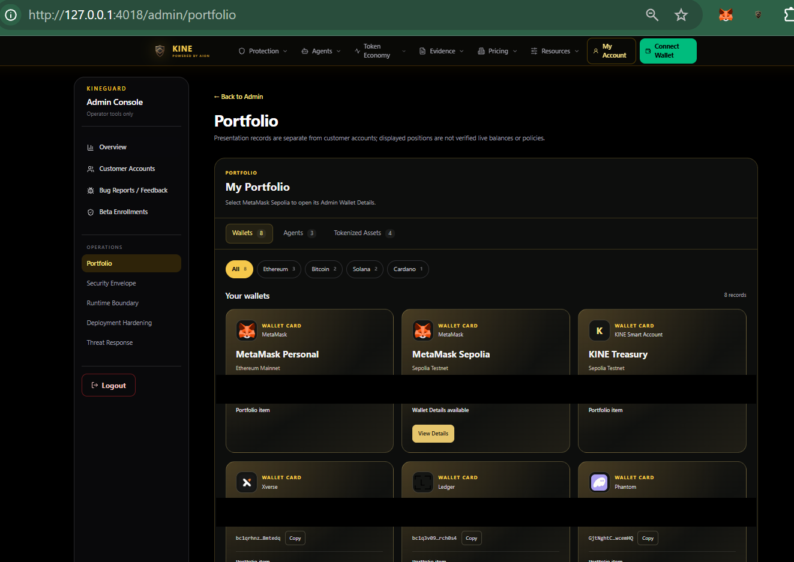
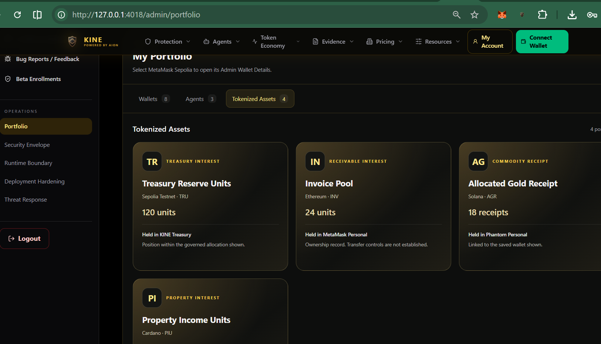
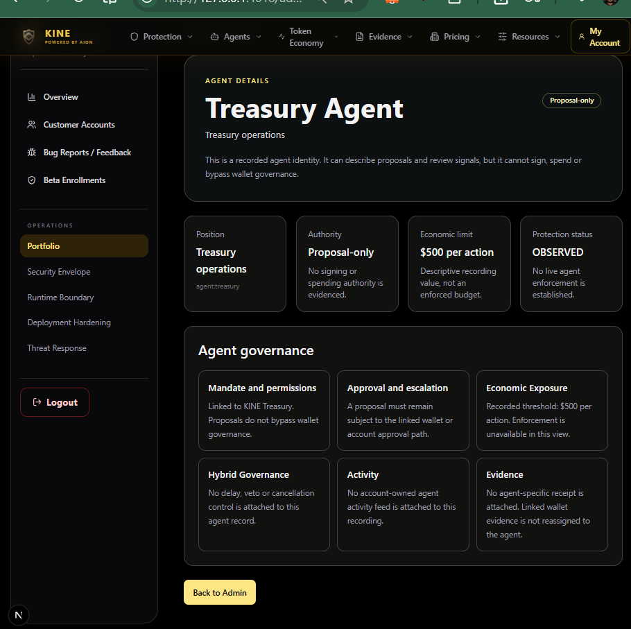
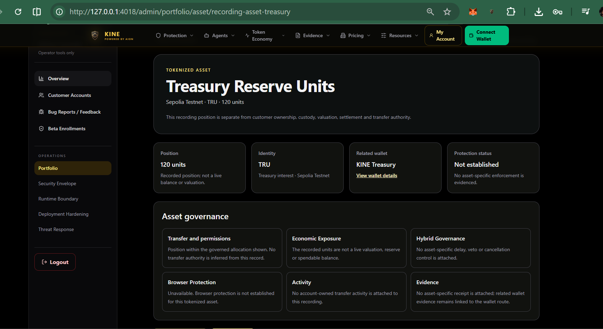
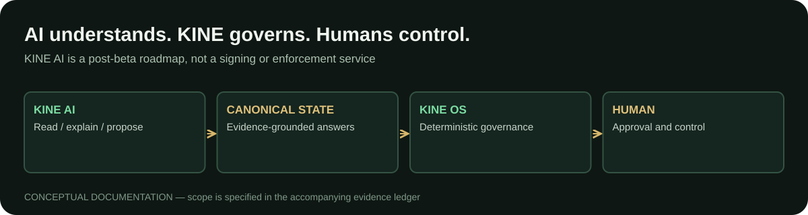

# KINEGuard · KINE OS

**KEY IS NOT ENOUGH**

[Español](README.md) · [English](README_EN.md) · [Full manual](docs/en/index.md)

**Investor/AI diligence:** [Company EN](company.md) · [Company ES](company_es.md) · [Milestone-based funding plan](docs/en/investor/scale-plan.md)

## 1. Product and thesis

KINEGuard lets people inspect wallets, understand approvals, review consequences before signing and trace agents, decisions and evidence. KINE OS is the policy and governance plane, with enforcement only in verified paths. Connecting an EOA does not make it a governed account.

## 2. Practical user journey

1. Connect a wallet with public access in Connect.
2. Confirm address, chain and state in Wallet Posture.
3. Review allowances and spenders in Approval Intelligence.
4. Explore Action Review before committing a transaction.
5. Consult Guardian, Evidence and receipts with provenance.
6. Inspect Governed Protection and historical evidence as a separate path.

## 3. Every dropdown page and section

### Protection

| Option | Detailed guide | Real path |
|---|---|---|
| Connect | [Open](docs/en/menus/protection/connect.md) | [/connect](https://kineguard.com/connect) |
| Wallet Posture | [Open](docs/en/menus/protection/wallet-posture.md) | [/wallet-health](https://kineguard.com/wallet-health) |
| Approval Intelligence | [Open](docs/en/menus/protection/approval-intelligence.md) | [/approvals](https://kineguard.com/approvals) |
| Action Review | [Open](docs/en/menus/protection/action-review.md) | [/preview](https://kineguard.com/preview) |
| Guardian | [Open](docs/en/menus/protection/guardian.md) | [/guardian](https://kineguard.com/guardian) |
| Governed Protection | [Open](docs/en/menus/protection/governed-protection.md) | [/kine](https://kineguard.com/kine) |

### Agents

| Option | Detailed guide | Real path |
|---|---|---|
| Identity | [Open](docs/en/menus/agents/identity.md) | [/agent-arena#identity](https://kineguard.com/agent-arena#identity) |
| Permissions | [Open](docs/en/menus/agents/permissions.md) | [/agent-arena#permissions](https://kineguard.com/agent-arena#permissions) |
| Requests | [Open](docs/en/menus/agents/requests.md) | [/agent-arena#requests](https://kineguard.com/agent-arena#requests) |
| Decisions | [Open](docs/en/menus/agents/decisions.md) | [/agent-arena#decisions](https://kineguard.com/agent-arena#decisions) |
| History | [Open](docs/en/menus/agents/history.md) | [/receipts#history](https://kineguard.com/receipts#history) |

### Token Economy

| Option | Detailed guide | Real path |
|---|---|---|
| Reasoning Needed? | [Open](docs/en/menus/token-economy/reasoning-needed.md) | [/token-economy#reasoning-needed](https://kineguard.com/token-economy#reasoning-needed) |
| Reuse | [Open](docs/en/menus/token-economy/reuse.md) | [/token-economy#reuse](https://kineguard.com/token-economy#reuse) |
| Provider Calls | [Open](docs/en/menus/token-economy/provider-calls.md) | [/token-economy#provider-calls](https://kineguard.com/token-economy#provider-calls) |
| Measurements | [Open](docs/en/menus/token-economy/measurements.md) | [/token-economy#measurements](https://kineguard.com/token-economy#measurements) |

### Evidence

| Option | Detailed guide | Real path |
|---|---|---|
| History | [Open](docs/en/menus/evidence/history.md) | [/receipts#history](https://kineguard.com/receipts#history) |
| Structured Records | [Open](docs/en/menus/evidence/structured-records.md) | [/receipts#structured-records](https://kineguard.com/receipts#structured-records) |
| Sessions | [Open](docs/en/menus/evidence/sessions.md) | [/session-intelligence](https://kineguard.com/session-intelligence) |
| Audit | [Open](docs/en/menus/evidence/audit.md) | [/audit](https://kineguard.com/audit) |

## 4. Authentic gallery: identical ES and EN images

| Surface | Controlled-local product image |
|---|---|
| Spending Limits |  |
| Admin Sepolia |  |
| Wallet Portfolio |  |
| Tokenized Assets |  |
| Treasury Agent |  |
| Agent Arena |  |
| Token Economy |  |
| Wallet Posture |  |
| Treasury Reserve |  |

The screenshots are from controlled-local KINEGuard, not certification of the Hostinger deployment. [Screenshot manifest](evidence/screenshot-manifest.md).

## 5. Architecture and protection states

OBSERVED, PRE-EXECUTION COVERED and KINE GOVERNED are different states. Signing, decision, forwarding, execution and confirmation are also different events.

[Architecture](docs/en/architecture.md)

## 6. Veto, timing and hybrid governance

Browser Cancel/DENY before MetaMask is not the contractual Safety Authority veto. HARDEN can tighten protection; WEAKEN requires delay/review when the policy demands it. GP1A and V3 are historical Sepolia-scoped tests.

[Technical guide](docs/en/architecture.md)

## 7. Economic Exposure

More than one transfer cap: cumulative capacity, rolling windows, realized, reserved, delegated, remaining, anti-fragmentation and concurrency. A conceptual calculation does not prove a production BOUND.

[Mechanism chapter](docs/en/architecture.md)

## 8. The nine controls and their limits

1. Spending Limits
2. Protected Funds
3. Browser Protection
4. Emergency Controls
5. Recipient Rules
6. App Approvals
7. Agent Access
8. Transaction History
9. Security Decisions

[Controls manual](docs/en/controls.md)

## 9. Agents, Token Economy and KINE AI

Agent identity, proposal-only authority or BYOK keys do not confer wallet signing. Token Economy measures or estimates inference work, not asset limits. KINE AI is a roadmap: AI understands; KINE governs; humans retain control.

[Agents](docs/en/menus/agents/index.md) · [Token Economy](docs/en/menus/token-economy/index.md)

## 10. Historical proofs and evidence authority

GP1A T1–T4 covers supported Chrome/MetaMask/Sepolia requests. V3 3B-1 through 3B-4 proves allowed, pending, veto and maturity for native ETH in a governed Sepolia account. Neither certifies current deployment.

[Proofs](docs/en/historical-proofs.md)

## 11. VAIOS/Claude research and integration

The manual supports conceptual pre-sign research linking agent, identity, authentic policy, decision, veto and receipt, without claiming partnership or released integration.

[AGENTS.md](AGENTS.md) · [llms.txt](llms.txt) · [Capability Catalog](docs/capability-catalog.json)

## 12. Limitations and references

Observed UI, CI tests, local images, Sepolia proof and roadmap require separate labels. KINEGuard does not provide universal EOA blocking, certified mainnet protection or a hosted immutable audit archive in beta.

[https://kineguard.com](https://kineguard.com) · [Complete manual](docs/en/index.md)

## 13. Chrome Extension — Before-provider protection

The MV3 extension now has a dedicated manual covering warnings, exact requests, ALLOW/WARN/DENY, Continue/Cancel, observability failures, traces and historical GP1A Chrome/MetaMask/Sepolia proof. It also maps planned compatibility with Rabby, Coinbase, Solana, Bitcoin, hardware, Safe and WalletConnect **without claiming those wallets have already passed equivalent blocking tests**.

- [Full extension manual (EN)](docs/en/chrome-extension/index.md)
- [Wallet coverage and readiness (EN)](docs/en/chrome-extension/wallet-coverage.md)
- [Proofs, screenshots and limits (EN)](docs/en/chrome-extension/proofs-and-screenshots.md)

## 14. Company Profile and Scale-Up

See the [English AI-readable company profile](company.md), its [Spanish mirror](company_es.md) and the [hiring, stage-gated capital and go-to-market plan](docs/en/investor/scale-plan.md). Targets and capital envelopes are illustrative—not raised capital, verified customers or revenue.
