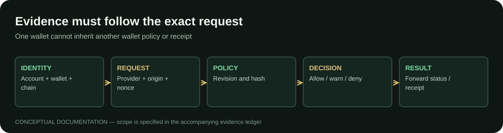

# Architecture — KINE OS and KINEGuard

## The economic authorization problem

A valid key is proof of cryptographic authority to sign; it does not describe a user's desired economic limits. The KINE research goal is to make policy, exposure, review windows and evidence meaningful across supported execution paths. KINEGuard is the customer-facing surface; KINE OS owns deterministic security governance.

## Layer inventory

| Layer | Purpose | Evidence boundary |
|---|---|---|
| Customer account | Session, owned wallet records, identities, wallet/provider/chain context | Being logged in does not make an external EOA governed |
| Wallet connectors | Read address/chain, provider state, portfolio observations | No interception just because a wallet is connected |
| Browser MV3 adapter | Normalize a supported request, hold it, show consequence, Continue/Cancel/deny | Cannot constrain transactions routed outside the wrapper |
| Canonical policy | Account-owned current rule, policy revision/hash and scope | Saving a policy is not executing/enforcing it |
| Governance kernel | Authorizes/denies a supported action in context | Cannot assume universal providers or methods |
| Economic Exposure | Cumulative authority bounded over time/pending/delegated capacity | No production BOUND proof from a demo figure |
| Smart account V2/V3 | Contract-level governed execution, delay and separate authority | Historical physical evidence native ETH Sepolia only |
| Safety Authority | Independent veto of an exact pending governed operation | Not interchangeable with Guardian brand/tier or UI Cancel |
| Agent Arena | Visibility and potential bounded agent delegation | BYOK is not spend permission; no unrestricted signing |
| Account/Guardian | Posture, decisions, events, activity, evidence and supervision | Must not mix observation/receipt/mined status |
| KINE AI | Grounded explanatory and eventual proposal interface | Post-beta roadmap; never sovereign execution authority |

## Canonical binding requirement

A governed decision should be scoped to at least `customer_account_id`, `record_id`, `wallet_address`, `chain_id`, `provider`, `session/currentness`, `origin/tab where applicable`, `exact request/action`, `policy ID/revision/hash`, `authority` and `evidence`. The goal is to prevent Wallet B's policy or receipt from being applied to Wallet A. A mismatch, stale context, replay, revoked policy, interrupted evaluator or unknown origin must not silently permit forwarding.

## Three coverage states

**OBSERVED:** wallet posture and activities visible; no enforcement implied. **PRE-EXECUTION COVERED:** supported wrapped request held and evaluated before provider forwarding; the EOA can still act on other paths. **KINE GOVERNED:** the relevant assets/action are actually governed by verified contract authority, limited to the contract and asset type under proof.

## Hybrid sovereignty, precisely

Human control and security enforcement coexist only within their actual scopes. The user may retain signing ability while a governed account enforces independent constraints. An off-chain browser veto protects a request within a supported wrapper; it is not a cryptographic restriction on an otherwise independent EOA. An on-chain V3 veto operates at a different layer and requires its designated authority.

## Source

[Master customer beta protocol](https://app.notion.com/p/41bd5f4fa5e3814e948bf911dddef7ef) · [Account-first UX doctrine](https://app.notion.com/p/3cfd5f4fa5e3813a987ac3fc1f616f07) · [Creation Bible](https://app.notion.com/p/3d0d5f4fa5e381b7a456d72685964ee4). These are cited source authorities; this public page is a summarized, non-sensitive derivative.
