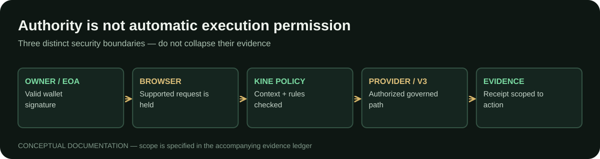

# Wallet coverage and hybrid sovereignty

## Threat model

A connected EOA is not automatically a protected account. The dangerous assumption is that wallet connection, observed balance, or a visible policy selector equals authority over every future action.

## Operation

KINEGuard separates wallet identity, account ownership, chain context, provider context, policy state, and evidence. A governed account can add a KINE policy boundary, while the human wallet remains the authorization boundary for supported actions. This is hybrid sovereignty: software can evaluate and govern a supported request without silently becoming the user's unrestricted custodian.

## Evidence and limits

The public evidence is `UI / READ-ONLY` for posture surfaces and bounded historical test evidence for specific governed paths. It does not establish universal EOA, ERC-20, mainnet, or cross-chain enforcement. See [Protected Funds](../../mechanisms/02-protected-funds.md) and [Browser Protection](../../mechanisms/03-browser-protection.md).

## Coverage state machine and negative cases

- **OBSERVED:** wallet address, chain or balance was read; no permission to govern spending is proven.
- **PRE-EXECUTION COVERED:** this exact supported dApp request is held by the installed adapter, bound to wallet, provider, origin, session and policy revision.
- **KINE GOVERNED:** the action is mediated by a real governed account contract under verified native authority. A wallet can be observed without its EOA asset balance being in a V3 contract.

Negative test obligations: Wallet A cannot inherit Wallet B's policy/nonce; changing chain/provider/session invalidates a pending capability; requests outside the adapter are not represented as blocked; contract protection cannot be inferred from the presence of a UI toggle.

**User takeaway:** a key can remain in human custody while the *governed execution path* adds independent economic constraints. Where the user chooses an unconstrained EOA route, the project must communicate the limits, not pretend a universal freeze exists.
