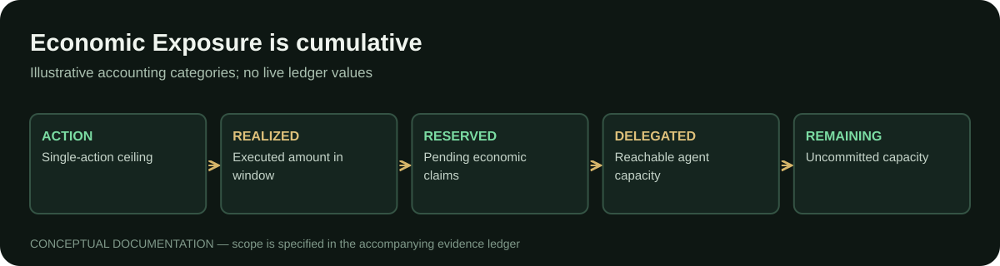

# Economic Exposure

Economic Exposure answers a different question from a single transaction limit: how much authority can remain reachable across time, pending reservations, and delegated actors?

## Illustrative model

The local demo may show illustrative values for maximum single action, rolling cumulative limit, accounting window, realized exposure, pending reservations, delegated authority, and remaining capacity. These values are deterministic documentation data, not a production reading.

Capacity can change when an action is finalized, fails, expires, or remains reserved only where the underlying canonical mechanism defines that transition. Repeated smaller transfers can fragment a naive single-action check, so cumulative accounting and policy-specific boundaries must be tested together.

## Status

Production `BOUND` verification is not claimed. Economic Exposure remains a roadmap or bounded research topic until its canonical authority, persistence, concurrency, rollback, and independent readback are proven for the stated scope.

## Why fragmentation matters

Imagine a 1,000-unit per-action cap and a 3,000-unit rolling budget. Ten transfers of 600 units are each below 1,000 but sum to 6,000. A security design must define how realized value, pending reservations, delegated reachable authority and time-window rollover interact, and it must prevent two concurrent actions from oversubscribing the same remainder. This is a **teaching scenario**; it does not assert which operations are already deployed.

For a fully worked illustrative model, see [Economic Exposure model](../economic-exposure-model.md). Key unresolved certification axes: authoritative policy and asset scope, concurrency, reservation lifecycle, account isolation, rollback, expiry, replay, and independent readback after refresh/restart.
