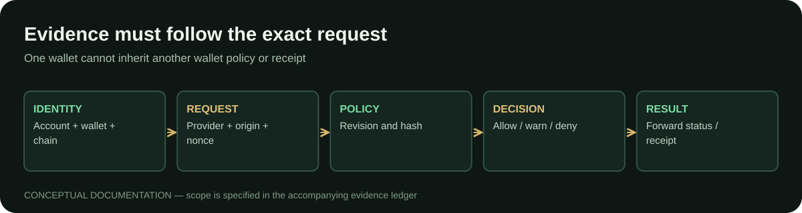

# Agents, Guardian, and evidence lineage

Agents may be observable subjects of governance without receiving unrestricted wallet-spend authority. Delegation, budgets, approvals, and recipient restrictions must remain account- and wallet-bound.

Guardian is the human-facing monitoring and intervention concept around risk, activity, decisions, and evidence. Activity observations, policy-change receipts, provider outcomes, and chain confirmations must remain separate records. A stored policy-change receipt is not proof that a transaction was sent, blocked, or finalized.

The current public classification is `UI / READ-ONLY` or `LAB / CI VERIFIED` according to the mechanism matrix. Complete decision-to-forward receipt correlation is not certified.

## Agents and human parity

An agent's tool credentials, model API keys or BYOK credentials do not themselves convey custody or signing rights. A meaningful delegation is tied to account/record/wallet, allowed methods/assets, recipients, spending budget, validity window, agent identity, policy revision and receipt lineage. Human and agent actions are subject to the same deterministic economic governance where a real governed path exists.

## Guardian versus Safety Authority

Guardian is the operational surface that helps a person see posture, pending weakening, risky approvals and linked evidence. Safety Authority is a separate technical/on-chain role in historical V3 experiments. One does not imply the other.

## Evidence lineage

Transaction list, provider request, policy change, blockchain receipt and on-chain finality are separate concepts. A trustworthy view must say "observation only" when it cannot verify the transaction; an expired local observation must not reveal records belonging to another account.
