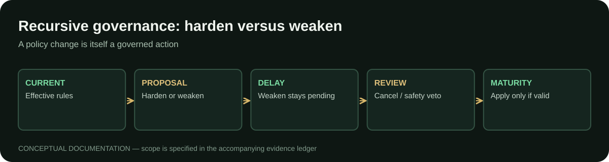

# KINE OS architecture and mechanisms

## 1. Principle

A valid key authorizes signing, not unlimited economic permission. KINEGuard observes and explains; KINE OS governs supported paths through identity, policy, risk, budget and evidence.

## 2. States

OBSERVED means inspection; PRE-EXECUTION COVERED means a supported request evaluated before the provider; KINE GOVERNED means an asset/action inside a verifiable governed contract. Do not conflate.

## 3. Veto and timing

Browser Continue/Cancel and Safety Authority on-chain veto are different capabilities. HARDEN tightens rules, WEAKEN may remain pending with delay, review and maturity. Expiry and replay require exact scope.

## 4. Economic Exposure

Max single action, rolling capacity, realized, reserved, delegated and remaining require correct accounting and protection against fragmentation/concurrency. Production BOUND proof remains open.

## 5. Agents and AI

Agents may propose; BYOK and UI permissions do not confer signing rights. Token Economy measures inference. KINE AI cannot replace the deterministic kernel.

## 6. Evidence

An observation is not an execution receipt; policy-change is not finality. Historical Sepolia proofs do not certify Hostinger or ERC-20/multichain.

