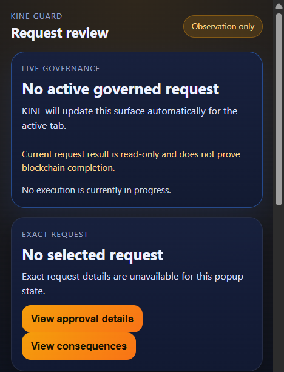
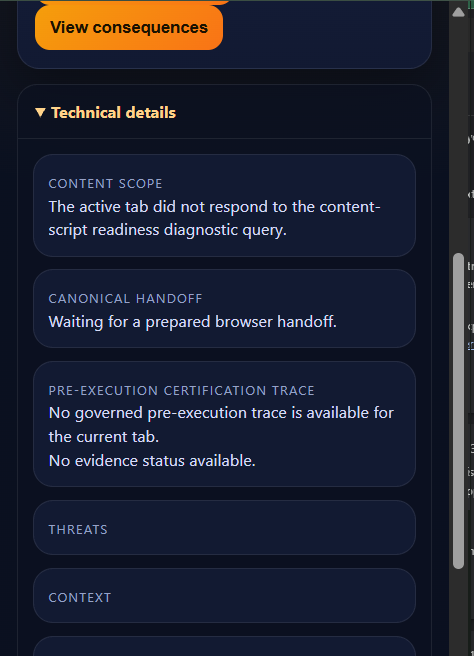
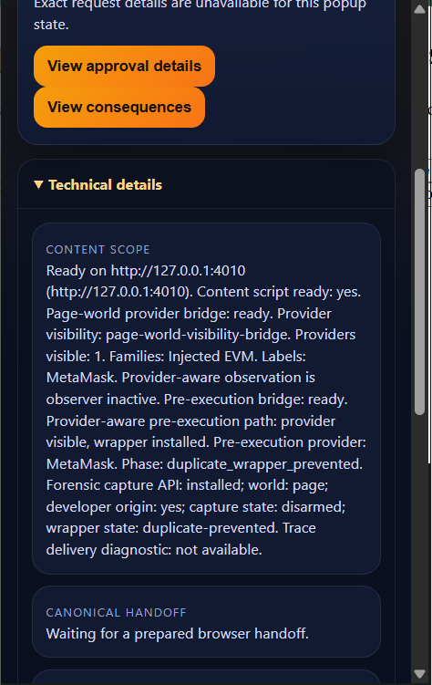
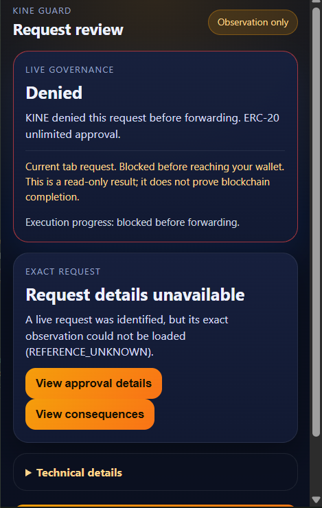
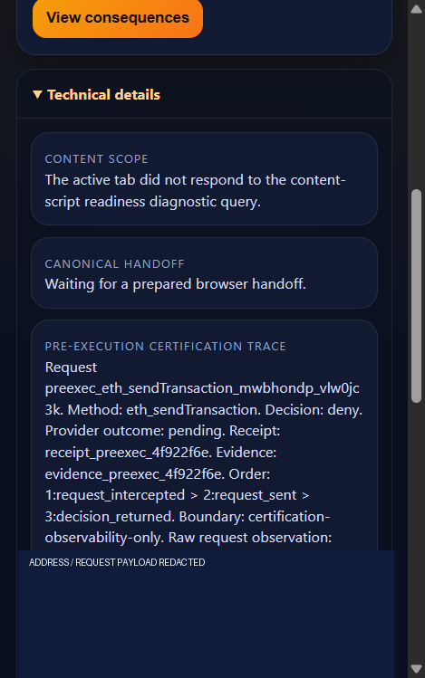

# KINEGuard Chrome Extension — Technical and user manual

[Español](../../es/chrome-extension/index.md) · [English](../../en/chrome-extension/index.md) · [Wallet compatibility](wallet-coverage.md) · [Proofs and screenshots](proofs-and-screenshots.md)

> **Scope:** MV3 extension historically tested in a specific Chrome + MetaMask + Sepolia flow. Controlled-local screenshots dated November 10, 2026. The current hosted site describes its extension layer as observation and beta warnings. This does not establish universal protection for all wallets or attacks.

## 1. Purpose and the attacks it aims to prevent

The extension is an assessment layer for dApp-initiated requests. In interceptable EIP-1193 paths it aims to identify and evaluate a request **before** the wallet provider receives it. It explains human consequences and produces ALLOW, WARN or DENY under a policy; the UI supports human Continue/Cancel only when the state allows it. Threat examples include unlimited allowances, suspicious spenders, unknown calldata, risky transactions or signatures, and stale or mismatched request identity. This protects a particular execution path; it is not comprehensive device protection or asset custody.

## 2. How to use it in an authorized test

1. Use a verifiable extension build and MV3 package. The chrome://extensions “Load unpacked” workflow shown in the screenshots is for development/QA, not certified production distribution.
2. Use an isolated browser profile, a disposable Sepolia account and test assets only; never import seed phrases or secrets into the harness.
3. Open the local EIP-1193 request harness and check that the installed provider is visible. A Content Scope no-response diagnostic or “No selected request” does not establish active interception.
4. Choose an explicit scenario: benign connection, signature, zero-value, safe approval, unlimited approval, suspicious spender or unknown calldata. Harness button labels are not test outcomes.
5. Open the popup and inspect Request review, governance status, exact request, warnings and technical details. Confirm they correspond to the current tab and request.
6. For DENY, do not attempt Continue or assume MetaMask was contacted; retain the error and trace. For ALLOW or WARN, continue only if the path permits Continue and the request is still current.
7. Confirm separately whether the provider was called, MetaMask displayed the request, the user approved and an on-chain hash/receipt exists. These are four distinct facts.

## 3. Supported-path architecture

The MV3 adapter combines a content script, page-world bridge, EIP-1193 normalization, background/service worker, decision owner and popup. The conceptual flow is:

```text
dApp → discovered EIP-1193 provider → exact request held
  → KINE normalizes method, payload and context
  → governors: identity, policy, risk, budget, evidence
  → ALLOW | WARN | DENY
  → consequence + human disposition when applicable
  → current request revalidation
  → at-most-once forwarding, only when allowed
  → provider outcome/receipt; separate on-chain confirmation
```

The design requires exact binding of tab, frame, document/origin, provider, wallet, chain, session, epoch, method, action and policy revision. Changes must invalidate continuation. An old assessment must not become portable authorization.

## 4. Decisions, notifications and state

| State or signal | Meaning | What it does NOT prove |
|---|---|---|
| ALLOW | Policy permits the current request on the evaluated path | Not signed or mined |
| WARN | Uncertain risk/decoding; show warning and consequence | Does not declare unknown calldata safe |
| DENY / BLOCK | Request rejected by policy on supported path | Does not mean all external paths were blocked |
| Continue | Human disposition on a current request where KINE allows it | Not MetaMask confirmation |
| Cancel | Human stops a held request handoff | Not a contract-level on-chain veto |
| Observation only | Popup in observation mode, without proof of enforcement in this view | Not global blocking |
| No active governed request | No selected governed request for the tab | Not evidence of active interception |
| Request details unavailable | Exact request observation unavailable (e.g., REFERENCE_UNKNOWN) | Do not invent exact binding |
| Content Scope not ready | Tab did not respond to content-script readiness diagnostic | Not a certified covered request |
| Canonical handoff waiting | No prepared handoff is available | Not proof of forwarding |
| Provider outcome pending | Provider outcome not yet received/confirmed in the trace | Do not claim forwarded or on-chain verified |

## 5. Attack patterns and classification

| Pattern | Intended response / evidence | Boundary |
|---|---|---|
| Malicious spender | GP1A T4 historical DENY with no forwarding observed | Supported Chrome/MetaMask/Sepolia |
| Unlimited ERC-20 approval | Allowance, spender and risk explanation; WARN/BLOCK depends on policy | Harness button does not prove all scenarios |
| Unknown calldata | Historical GP1A T3 WARN and Cancel | Not all calldata is decodable |
| Benign/zero-value transaction | GP1A T1: held and Continue opened MetaMask | No confirmed transaction |
| Human cancellation | GP1A T2: MetaMask did not open | Only current request |
| Wallet/chain/provider switch | Fail closed, revalidate before Continue, invalidate stale context | Requires integrated-build regression |
| Personal signature or typed data | Harness exposes benign fixtures; intended for evaluation | Do not infer proven blocking of all messages |
| Compromised key or out-of-browser transfer | Only governed account/contract can enforce within its own scope | Extension does not intercept unrelated routes |

## 6. Popup content and human explanation

The observed UX shows Request review, LIVE GOVERNANCE, Denied, Observation only, Exact Request, View approval details, View consequences and Technical details. “View consequences” and “View approval details” help interpret a request; their presence without a selected request proves no exact data. Technical details includes Content Scope, Canonical Handoff, Pre-execution Certification Trace, Threats and Context, with ID, method, outcome, receipts and ordering when available. One screenshot shows both “Denied” and “Request details unavailable”: both signals are documented, without claiming that exact request identity was established by the picture.

## 7. Evidence and traceability

A correct record separates request_intercepted, request_sent for evaluation, decision_returned, human disposition, provider forwarding, MetaMask outcome and on-chain transaction. A trace with decision=deny and provider outcome=pending is partial observation until no-forwarding is corroborated by the harness or provider evidence. November's trace contains certification fields alongside limited Content Scope and Handoff diagnostics. Policy-change receipts and blockchain receipts are distinct entities.

## 8. Sepolia GP1A proof and regression

Historically documented outcomes: T1 held zero-value request, Continue opened MetaMask without on-chain confirmation; T2 Cancel prevented MetaMask opening; T3 unknown calldata caused WARN and Cancel without opening MetaMask; T4 suspicious approval caused BLOCK and MetaMask stayed closed. R39B documented 12/12 UX, 15/15 harness, 6/6 adversarial and an earlier 117/117 regression at that revision; these are historical revision-scoped results, not current deployed acceptance. Contract-governed V3 3B-1 through 3B-4 is a distinct veto class, tested using native ETH in a governed Sepolia account.

[Historical proofs EN](../historical-proofs.md)

## 9. Other wallets and ecosystem expansion

The architectural objective is to reuse the same governance invariants (identity, authentic policy, exact request, budget, decision, handoff and receipt) across heterogeneous wallet adapters. **A single Chrome wrapper does NOT automatically intercept Solana, Bitcoin, WalletConnect, hardware wallets or all native apps.** EVM uses an EIP-1193/EIP-6963 foundation; Solana needs its own transaction, program, instruction and provider semantics; Bitcoin needs PSBT/script/UTXO handling and native proofs; Safe/smart accounts need contractual guards/modules; hardware requires signed-flow integration. See the [wallet matrix](wallet-coverage.md).

## 10. Difference from KINE OS, SDK and on-chain enforcement

| Layer | Function | Actual boundary |
|---|---|---|
| Website | Read-only inspection and preview | Page does not sign or intercept |
| Chrome Extension | Context warnings; historical scoped pre-provider blocking proof | Current website describes observation beta, not universal blocking |
| SDK/API | Handoff for cooperating clients | Does not monitor non-integrated paths |
| Governed smart account | Contract policy restricts covered actions even with valid key | Historical scoped Sepolia proof |

## 11. Privacy, security and installation

Do not publish extensions with private user identifiers, session data, full wallet addresses linked to a person, full request traces, cookies or secrets. November 10 screenshots were precisely cropped to exclude Chrome/Google UI; one trace also has part of address/payload redacted. They are genuine local visual evidence, not the full experiment and not a production-user installed extension. Approved-build distribution should be documented separately when available.

<!-- KINE_EXTENSION_GALLERY_START -->
### popup-no-active-request.png



**CONTROLLED_LOCAL, 2026-11-10** — UI local: sin solicitud activa; observación, no enforcement. Not a production Hostinger capture or proof of universal enforcement.

### popup-content-scope-not-ready.png



**CONTROLLED_LOCAL, 2026-11-10** — UI local: diagnóstico content script sin respuesta. Not a production Hostinger capture or proof of universal enforcement.

### popup-provider-bridge-ready.png



**CONTROLLED_LOCAL, 2026-11-10** — UI local: bridge listo en origen de laboratorio. Not a production Hostinger capture or proof of universal enforcement.

### popup-denied-before-forwarding.png



**CONTROLLED_LOCAL, 2026-11-10** — UI local: solicitud sospechosa DENY antes del proveedor; status observation-only. Not a production Hostinger capture or proof of universal enforcement.

### popup-preexecution-trace.png



**CONTROLLED_LOCAL, 2026-11-10** — UI local: traza mostrada sin dirección completa. Not a production Hostinger capture or proof of universal enforcement.

<!-- KINE_EXTENSION_GALLERY_END -->

## 12. Sources and claim levels

- [KINEGuard master protocol](https://app.notion.com/p/41bd5f4fa5e3814e948bf911dddef7ef)
- [Wallet-to-KINE execution boundary thesis](https://app.notion.com/p/379d5f4fa5e38136967dfd04e030195b)
- [G5 / R39B extension evidence and roadmap](https://app.notion.com/p/3bfd5f4fa5e38099ac86cbb1ed02ae91)
- [Public governed protection](https://kineguard.com/kine)
- [Public wallet coverage and current limits](https://kineguard.com/connect)
- [EIP-1193 specification](https://eips.ethereum.org/EIPS/eip-1193)
- [EIP-6963 multi-provider discovery](https://eips.ethereum.org/EIPS/eip-6963)

Promotion to VERIFIED is per wallet: detection → connection → normalization → guard preview → receipt-backed block/veto → environment verification. A wallet listed under Connect does not inherit MetaMask's PASS.

[Wallet-by-wallet coverage](wallet-coverage.md) · [Screenshots and proof](proofs-and-screenshots.md)
