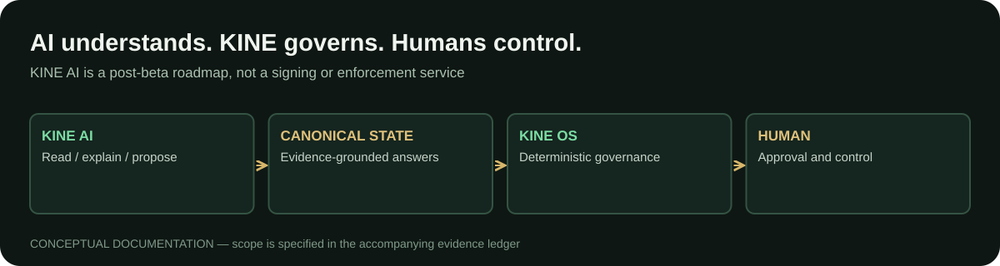

# KINE AI Intelligence

**Evidence class: DESIGN / ROADMAP**

KINE AI is the natural-language intelligence interface to KINE OS. It is not merely a chatbot. Its intended role is to investigate, explain, and guide a person's economic reality from canonical state: wallets, assets, permissions, agents, policies, exposure, activity, receipts, and evidence.

## The authority boundary

KINE AI may understand, summarize, analyze, recommend, simulate, and propose. KINE OS retains governance, authority, enforcement, and evidence responsibility. Humans retain control. AI must not receive unrestricted signing authority, bypass governance, or directly override policy.

## Readiness roadmap

| ID | Capability | Readiness | Public claim |
|---|---|---|---|
| KAI-00 | Canonical intelligence architecture | DESIGN / ROADMAP | Define safe read owners and prohibitions |
| KAI-01 | Read-only intelligence | DESIGN / ROADMAP | First production target; not released |
| KAI-02 | Explain KINE | DESIGN / ROADMAP | Explain decisions, authority, and consequences |
| KAI-03 | Economic reality intelligence | DESIGN / ROADMAP | Grounded views of ownership, exposure, and coverage |
| KAI-04 | Evidence intelligence | DESIGN / ROADMAP | Investigate receipts and decisions |
| KAI-05 | Recommendation engine | DESIGN / ROADMAP | Recommendations remain non-executing |
| KAI-06 | Governed AI proposals | DESIGN / ROADMAP | Proposals must return to KINE governance |
| KAI-07 | AION intelligence bridge | DESIGN / ROADMAP | Future reasoning and retrieval integration |
| KAI-08 | Qiskit / Aer simulation | DESIGN / ROADMAP | Advisory analytical lane only |
| KAI-09 | Proactive KINE intelligence | DESIGN / ROADMAP | Future notices about meaningful state changes |

## Prerequisites

KAI-01 depends on consumer-grade KINE V3 productization, account and wallet isolation, reliable canonical reads, and human acceptance. The first target is read-only intelligence and is not a released product capability. Additional local evidence remains **PENDING EXTERNAL REVIEW** and is not presented as verified here.

AION bridges, proactive intelligence, and specialized simulation are future capabilities unless a separate evidence record proves a narrower scope. The interactive demo in this atlas is simulated and performs no model calls.

See the [claim-to-evidence matrix](../../evidence/claim-to-evidence.md) and [capability matrix](../capability-matrix.md).

## Architecture illustration

KINE AI is a research/roadmap capability, not a released wallet-signing agent.
