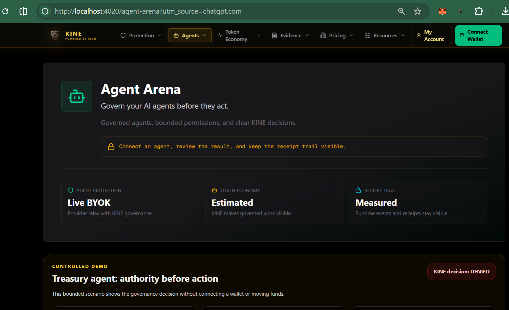

# Agents

[ES](../../../../docs/es/menus/agents/index.md) · [EN](../../../../docs/en/menus/agents/index.md) · [Manual](../../index.md)

All options from the actual dropdown are documented separately, with instructions and verified boundaries.

| Option | Guide | Target |
|---|---|---|
| Identity | [Read instructions](identity.md) | [/agent-arena#identity](https://kineguard.com/agent-arena#identity) |
| Permissions | [Read instructions](permissions.md) | [/agent-arena#permissions](https://kineguard.com/agent-arena#permissions) |
| Requests | [Read instructions](requests.md) | [/agent-arena#requests](https://kineguard.com/agent-arena#requests) |
| Decisions | [Read instructions](decisions.md) | [/agent-arena#decisions](https://kineguard.com/agent-arena#decisions) |
| History | [Read instructions](history.md) | [/receipts#history](https://kineguard.com/receipts#history) |

*Related local-product image; not production proof.*
