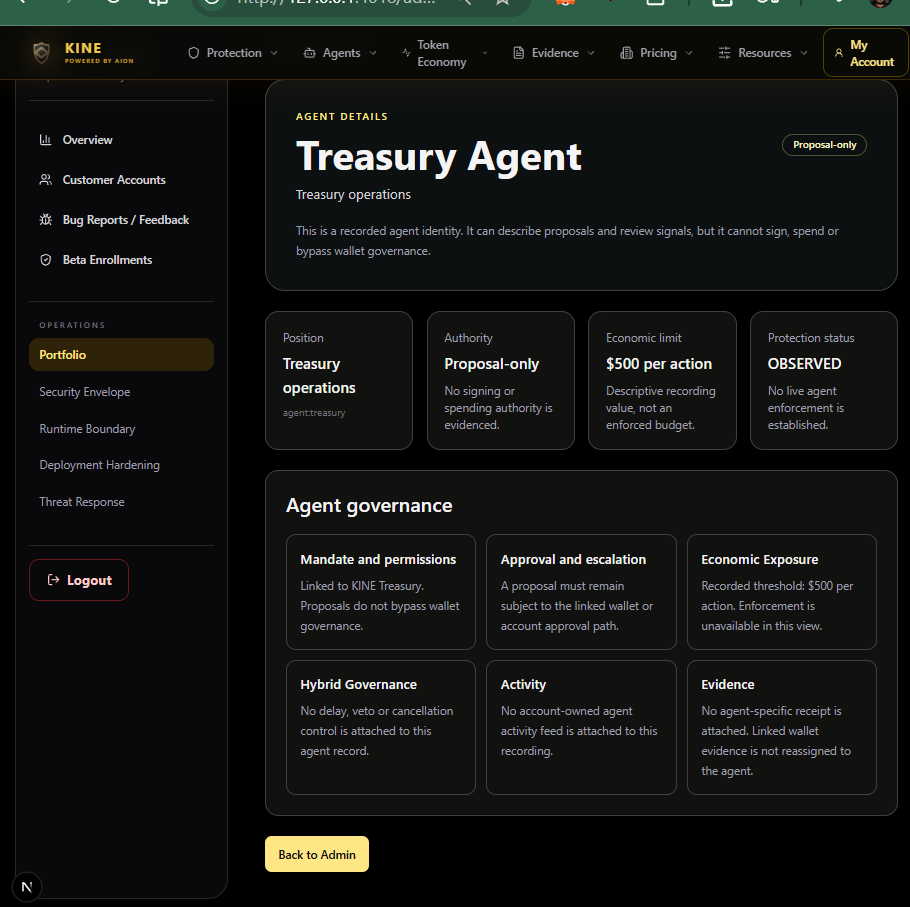

# Agents / Permissions

[ES](../../../../docs/es/menus/agents/permissions.md) · [EN](../../../../docs/en/menus/agents/permissions.md) · [Index](../../index.md)

**Route:** [/agent-arena#permissions](https://kineguard.com/agent-arena#permissions) · **Kind:** in-page anchor

## 1. Purpose

Describes an agent's permissions, budgets, actions, assets and time limits.

## 2. How the user operates it

1. Enter Permissions and select the same agent and economic object you are investigating.
2. Distinguish Proposal-only, observation, simulation and verified delegation.
3. Check max action, destinations, assets and budget only when a policy source exists.
4. Follow the corresponding request to Decisions for outcome and receipt.

## 3. Underlying mechanism

This route belongs to the Agents family and must be interpreted with identity, policy, exact request and evidence provenance.

## 4. Evidence and limitations

A $500 limit on a local card can be descriptive rather than an enforced contract budget.

A visible public screen does not equal human runtime acceptance or universal funds protection.

Bounded read delegation has synthetic CI evidence. The separate native monetary grant remains an undeployed contract candidate: the original contract revision passed 12/12 local EVM tests; the successor requiring an individual signed decision failed Solidity compilation; customer policy integration and signer custody pending. This screen does not confer effective spending authority.

## 5. Related image

*Genuine related controlled-local KINEGuard image; not a certified screenshot of this URL on Hostinger.*

## 6. Sources

- [Public UI](https://kineguard.com/agent-arena#permissions)
- [KINEGuard master protocol](https://app.notion.com/p/41bd5f4fa5e3814e948bf911dddef7ef)
- [Architecture](../../architecture.md)
- [Historical proofs](../../historical-proofs.md)

[← Back to menu](index.md)

**Account candidate:** repaired contract passed local EVM stage; integrated regression pending. Native-budget form evaluates saved policy, recipient, pause and admission capacity. Favorable evaluation is NOT AUTHORIZED; no signature, reservation, durable receipt or execution. Form CI pending. [Mechanism](../../../../mechanisms/07-agent-access.md).

**Candidate update:** signed-decision contract 16/16 local EVM and 284/284 synthetic integrated PASS. New owner-and-agent signed EOA key association with persistence, expiry and revocation awaits CI. It does not establish software identity, register a contract or grant spending. [Mechanism](../../../../mechanisms/07-agent-access.md).

**Update:** saved-policy budget evaluation passed synthetic HTTP/UI CI (16/16 EVM, 284/284 integrated). Dual-key association E2E-05 stage passed; complete run pending. Internal registered-contract dual-RPC observation qualifier awaits CI, with no customer API or authority. [Mechanism](../../../../mechanisms/07-agent-access.md).

**CI closure:** dual EOA key association runtime PASS, integrated 284/284 and local EVM 16/16. No monetary authority or software identity; migration 034 synthetic only, not a production upgrade.

**Update:** synthetic RPC contract observation 22/22 PASS, 16/16 EVM and 284/284 integrated. New compiled-runtime reconstruction candidate with nine immutables and local EVM comparison awaits CI. Not live contract registration or spending authority. [Mechanism](../../../../mechanisms/07-agent-access.md).

**Update:** compiled provenance 18/18 controls within 17/17 EVM, 22/22 synthetic RPC and 284/284 integrated PASS. New account contract observation in View Details uses a sealed local fixture, current dual-key proof and policy binding; CI pending. No live registry or monetary authority outside the lab. [Mechanism](../../../../mechanisms/07-agent-access.md).

**Update:** laboratory account-bound contract observation PASS, 17/17 EVM, 22/22 RPC and 284/284 integrated. Agent-signed decision, durable receipt and atomic synthetic reservation candidate awaits CI; no spending authority or operation outside laboratory. Configured shared cap blocks reservation until cross-path accounting is integrated. [Mechanism](../../../../mechanisms/07-agent-access.md).

**Adjudication:** durable decision CI failed at TypeScript (two untyped numeric conversions); E2E skipped. Strict PostgreSQL input validation repair `fd357af` published, CI 45690781711 pending. No durable decision PASS. Last qualified integration `aa2a836`. [Mechanism](../../../../mechanisms/07-agent-access.md).

**Update:** durable decision repair passes TypeScript and build; E2E pending. Persistent invalidation candidate for pending dual-key challenges after successful association or explicit revocation, migration 036 and CI 45691992645 pending. Not on-chain revocation or spending authority. [Mechanism](../../../../mechanisms/07-agent-access.md).

**Confirmed result:** CI 45690781711 SUCCESS, durable laboratory decision and concurrent synthetic reservation PASS, 17/17 EVM, 22/22 RPC and 284/284 integrated. No executable signature or live capacity. Challenge invalidation successor pending.

**Update:** two pending challenge invalidations PASS, 17/17 EVM, 22/22 RPC and 284/284 integrated. New signed-request denial tests after pause, recipient/origin deny and cap change await CI; no shared accounting or live authority. [Mechanism](../../../../mechanisms/07-agent-access.md).

**Update:** shared conservative laboratory accounting candidate counts synthetic agent reservations toward browser cap and policy/proposal readback, with explicit breakdown. Outside lab browser-only accounting retained. Capped agent admission still fail-closed pending qualification; CI pending. No executable signature or real funds.

**Update:** cross-mechanism and shared browser/readback accounting PASS (CI 45693990497 and 45694513194). Bidirectional admission candidate with second local contract and 2 wei cap, concurrent competition and persisted sum; CI 45698689165 pending. No live registry or executable signature.

**Update:** candidate exact receipt preimage preservation and independent historical integrity verification, migration 037, seven receipts and seven planned negative controls; CI 45699228431 pending. No server authority authentication, current policy certification or executable signature. Historical receipts without original bytes are not reconstructed.

**Update:** bidirectional admission and seven receipt/seven negative integrity controls PASS, CI 45699228431. Local EVM execution candidate binds persisted receipt, current policy/association, distinct synthetic signer, two events and balance; CI 45705150397 pending. Local reproduction, not original chain continuity, production signing or real funds.

**Update:** persisted receipt → independent synthetic signer → local EVM execution PASS, CI 45705150397. Direct creation provenance candidate (transaction, constructor, value, CREATE address, receipt, block and runtime), 30 planned controls; CI 45707353028 pending. No live operator registration, independent finality or production signing.

**Update:** direct deployment provenance 30/30 PASS, CI 45707353028. Durable operator quarantine registry candidate with Admin intake/revocation and customer readback, migration 038 and CI 45708932605 pending. No live deployment certification, finality or production signature; registry revocation is not on-chain revocation.

**Update:** candidate two-configured-RPC quarantine deployment inspection, without authority promotion or independent finality certification. CI 45709491820 pending; possible HTTP 400/503 mismatch for altered RPC evidence. Previous registry CI pending. No signing or live execution.

**Update:** Admin quarantine registry and account readback PASS, CI 45708932605. RPC inspection CI 45709491820 FAIL due to HTTP 400 instead of 503; altered evidence rejected. Targeted repair `2843072`, CI 45711379065 pending. No live registry, authority or production signing.

**Update:** quarantined creation RPC inspection PASS, CI 45711379065. External authorizer key-control candidate bound to registry, policy and operator session, migration 039, CI 45715112656 pending. No production custody, executable permit or certified live registry.

**Update:** CI 45715112656 FAIL on four PostgreSQL timestamp TypeScript TS2769 errors; E2E skipped. Strict timestamp repair `ba2e68f`, CI 45716035102 pending. No newly qualified authorizer identity, production custody or executable permit.

## External authorizer key-control qualified — November 25, 2026

[CI 45716035102](https://github.com/VerifywithAION/aion-guard-ui/actions/runs/45716035102) completed SUCCESS on exact integration commit `ba2e68f1d44bf833c4e725662fbc1b150267d53b`. Job 139562197536 logs confirm `RUNTIME_PASS AGENT_EXTERNAL_AUTHORIZER_KEY_CONTROL` (identity proof only), `AGENT_OPERATOR_DEPLOYMENT_TWO_RPC`, `AGENT_OPERATOR_REGISTRY_QUARANTINE`, and `AGENT_LAB_RECEIPT_TO_EVM_EXECUTION`; direct deployment 30/30, synthetic RPC 22/22 and integrated regression 284/284 PASS. TypeScript repair qualified. This is CI-only proof of control of a synthetic external signer key, not protected custody, current production key control, executable authorization, live registry, chain finality or Sepolia execution. Next: protected external signer and fail-closed executable decision authorization in the same isolated draft PR, before any separately authorized live test. Human Acceptance 115, production backup/restore, isolated preview and release remain open; no deployment or production changes in this intervention.

## Configured external signer identity transport candidate — November 25, 2026

[Product candidate 2d939f1](https://github.com/VerifywithAION/aion-guard-ui/commit/2d939f1a8180dbc015bcf5a0c9141c83be535482) in the existing draft PR #18 adds an Admin-only remote identity proof action, server-configured HTTPS endpoint and bearer transport credential, exact persisted EIP-191 challenge, bounded timeout/response, no redirects, and independent signature verification plus repeated registry/policy/association checks after the network request. The synthetic CI fixture alone uses loopback and deterministic test keys. No private authorizer key or arbitrary digest is accepted from clients; no EIP-712 permit is issued. Negative tests cover wrong signer, mismatched challenge, outage, redirect, foreign origin/account, revoked registry and extra secret fields. CI 45718586693 in_progress, not yet qualified. This is a transport integration candidate, not HSM/KMS provisioning or verified non-exportable key custody. The external service and actual custody remain unqualified; no production changes, migration, on-chain movement or Human Acceptance. Last qualified product commit remains ba2e68f.

## Protected custody design decision — November 25, 2026 (proposal, not implementation)

Source review of `KineBoundedAgentNativeGrant.sol` at `2d939f1` confirms an immutable decision-authorizer address, low-s 65-byte secp256k1 signatures with v=27/28, and a maximum 60-second execution permit. The current transport CI 45718586693 remains unqualified. AWS KMS is the proposed first protected-key candidate (`ECC_SECG_P256K1`, `SIGN_VERIFY`, provider-generated key, fixed key ARN); see [key specs](https://docs.aws.amazon.com/kms/latest/developerguide/symm-asymm-choose-key-spec.html), [Sign](https://docs.aws.amazon.com/kms/latest/APIReference/API_Sign.html), and [CloudTrail](https://docs.aws.amazon.com/kms/latest/developerguide/ct-sign.html). Proposed isolated signer must compute its own domain-bound identity digest, normalize and independently recover the Ethereum signature, use a dedicated least-privilege workload identity, and produce independently checked provider audit evidence. No generic digest endpoint or execution permits during custody qualification. Key custody alone is not policy enforcement; the signer must independently enforce purpose and trusted state. Address rotation requires a new grant and explicit revocation/recovery of old grants; existing issued permits remain valid until expiry or on-chain revocation. No AWS resource, credential, billing commitment, live key, signature or deployment was created. Proposal only; provider selection remains subject to owner and live qualification. Last qualified product SHA remains `ba2e68f`.

## External signer transport — TypeScript repair, November 25, 2026

[CI 45718586693](https://github.com/VerifywithAION/aion-guard-ui/actions/runs/45718586693) at 2d939f1 completed FAILURE at TypeScript: seven TS2339 diagnostics accessing challengeId, message and expiresAt on the proof response union. Exact-blob provenance, direct deployment 30/30, synthetic RPC observation 22/22 and preceding source lint passed; integrated browser execution did not run. [Repair 5fe5c2a](https://github.com/VerifywithAION/aion-guard-ui/commit/5fe5c2ab09c4d6199d026c16c8e2417673fc892c) adds explicit property-presence guards before challenge access, preserving the existing status and nonempty guards, and updates the workflow blob pin. Exactly two files changed. Exact-head CI [45720496147](https://github.com/VerifywithAION/aion-guard-ui/actions/runs/45720496147) in_progress; no new PASS adjudicated. Last qualified product SHA remains ba2e68f. AWS KMS remains proposed, not implemented or provisioned. No production, contract, migration, funds or custody changes.

## External signer transport qualified; isolated AWS KMS identity candidate — November 25, 2026

Exact [CI 45720496147](https://github.com/VerifywithAION/aion-guard-ui/actions/runs/45720496147) at 5fe5c2a completed SUCCESS: runtime AGENT_EXTERNAL_SIGNER_TRANSPORT and AGENT_EXTERNAL_AUTHORIZER_KEY_CONTROL, 30/30 creation provenance, 22/22 synthetic RPC, 284/284 integrated. Transport qualification is synthetic only, not protected custody. [Candidate 6b51df5](https://github.com/VerifywithAION/aion-guard-ui/commit/6b51df517ba1acdeef6021ce1502f484c4e65e57) adds isolated API Gateway v2/Lambda handler, KMS DescribeKey/GetPublicKey/Sign adapter, strict EIP-191 Sepolia identity grammar, fixed provider-generated key ARN/address, DER decoding, low-s normalization, signature recovery and bounded expiry. Offline provider-response simulation uses real local ECDSA; 25 tests authored, not yet adjudicated. Four changed files including exact workflow pins. Exact CI [45723049642](https://github.com/VerifywithAION/aion-guard-ui/actions/runs/45723049642) in_progress. No real AWS call, deployed package, IAM/key policy, CloudTrail, nonexportable-key custody, independent signer registry checks or execution authorization qualified. No production, funds, deployment, or migration changes. Last qualified product SHA 5fe5c2a.

## KMS isolated adapter — partial CI evidence and packaging acceptance, November 25, 2026

Exact candidate 6b51df5 / [CI 45723049642](https://github.com/VerifywithAION/aion-guard-ui/actions/runs/45723049642): isolated KMS synthetic crypto test step SUCCESS (25 authored tests), TypeScript and focused lint SUCCESS; full run not yet completed. Last fully qualified product head remains 5fe5c2a. Package qualification specification (not implemented): independent Node.js 22 Lambda ZIP with pinned viem 2.49.3 (existing product lock) and explicitly pinned AWS SDK v3 client-kms plus complete lockfile, installed via npm ci --ignore-scripts; verify artifact SHA256, source pins, dependency inventory, clean extracted-package import and disabled-handler smoke, real SDK serialization using a simulated request handler (no AWS calls), and test archive without application files/secrets. IAM role scoped to exact key ARN: DescribeKey/GetPublicKey separately; Sign allowed only with kms:SigningAlgorithm=ECDSA_SHA_256 and kms:MessageType=DIGEST. Review key policy and permissions boundary, no generic signing route; KMS cannot distinguish economic from identity digests. API route identity-only, no request-body logging, throttling and audit correlation. Live qualification needs owner-authorized dedicated lab key/role, provider metadata and SPKI/address verification, actual EIP-191 proof and CloudTrail event evidence, wrong key/disabled/outage negative controls, zero on-chain movements, no production access. No package, AWS resources, credentials or costs created this intervention. See [Lambda ZIP](https://docs.aws.amazon.com/lambda/latest/dg/nodejs-package.html) and [KMS conditions](https://docs.aws.amazon.com/kms/latest/developerguide/conditions-kms.html).

## KMS synthetic crypto 25/25; shared-admission regression repair, November 25, 2026

Exact [CI 45723049642](https://github.com/VerifywithAION/aion-guard-ui/actions/runs/45723049642) at 6b51df5 completed FAILURE at E2E05: KMS 25/25, 0 failures, TypeScript, application build, direct deployment 30/30, synthetic observation 22/22, runtime external signer transport passed. Capped concurrent browser/agent admission returned 503 instead of 200 at test line 2169. Source review identifies lock-order inversion: browser receipt acquired wallet then session in INSERT, agent acquired session/account then wallet. PostgreSQL deadlock is a source-supported hypothesis, not confirmed by original database SQLSTATE. [Candidate repair 5f63346](https://github.com/VerifywithAION/aion-guard-ui/commit/5f633466ebd3a708ca8a7c616031bafe5879fd8e) locks exact active session, account, then wallet in browser receipt transaction, retains existing current-state guards and exact one-winner/cap assertions, adds route-specific status diagnostics and updates exact pins. Three files changed; no KMS/contract/migration changes. Exact CI [45725404805](https://github.com/VerifywithAION/aion-guard-ui/actions/runs/45725404805) in_progress. Last qualified full product SHA 5fe5c2a; adapter synthetic step passed but integrated candidate unqualified. Package remains unbuilt; no AWS resources, real signatures, production or transactions.

## Shared admission qualified; isolated package candidate — November 25, 2026 (MX)

Exact [CI 45725404805](https://github.com/VerifywithAION/aion-guard-ui/actions/runs/45725404805), 5f63346, completed SUCCESS. KMS 25/25, external transport runtime PASS, bidirectional shared-cap race PASS (browser BLOCK / agent LAB_RESERVED_NOT_AUTHORIZED), 284/284 integrated. The source lock-order correction is qualified in CI; the previous 503 SQLSTATE remains unobserved. [Candidate 4251403](https://github.com/VerifywithAION/aion-guard-ui/commit/4251403a6dd20b26c6f2d15d4367546c9ec2a42c) adds isolated manifest viem 2.49.3 and AWS SDK KMS 3.1178.0, disposable runner lock resolution, registry/integrity checks, npm ci, ZIP/extraction, mock SDK request serialization, 25 crypto regression tests, dependency inventory, SHA256SUMS and provenance. Five files changed, no contract or application changes. [CI 45733534998](https://github.com/VerifywithAION/aion-guard-ui/actions/runs/45733534998) queued at inspection. Local npm registry DNS unavailable; first lock must be generated in CI, independently reviewed and committed before a frozen release build. No actual ZIP verified yet, no AWS calls, live key, charges, transaction or deployment. Package candidate is not authorized to deploy. Last full qualified product SHA 5f63346.
