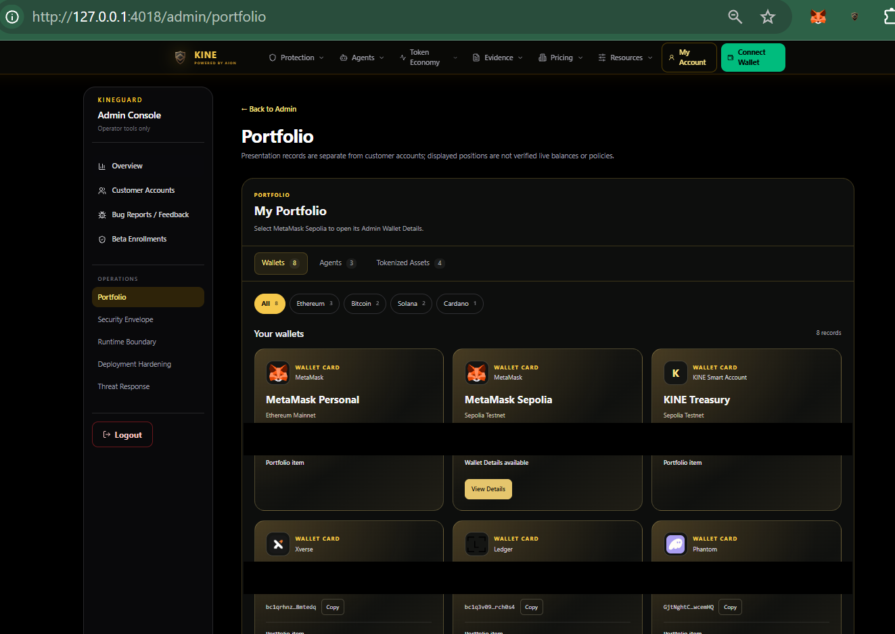

# Protection / Guardian

[ES](../../../../docs/es/menus/protection/guardian.md) · [EN](../../../../docs/en/menus/protection/guardian.md) · [Index](../../index.md)

**Route:** [/guardian](https://kineguard.com/guardian) · **Kind:** standalone page

## 1. Purpose

Monitors what needs attention across wallets: posture, alerts, approvals and evidence.

## 2. How the user operates it

1. Open Guardian and examine Available now, Partial in beta and the source of each card.
2. Check whether it shows demo profiles or your session; do not treat 3 demo profiles as real customers.
3. Prioritize alerts, review wallet health, approvals or the related agent and follow History links.
4. Check source and receipt before attributing an outcome to a wallet.

## 3. Underlying mechanism

This route belongs to the Protection family and must be interpreted with identity, policy, exact request and evidence provenance.

## 4. Evidence and limitations

Guardian as a product/tier is not Safety Authority and grants no on-chain veto or funds insurance.

A visible public screen does not equal human runtime acceptance or universal funds protection.

## 5. Related image

*Genuine related controlled-local KINEGuard image; not a certified screenshot of this URL on Hostinger.*

## 6. Sources

- [Public UI](https://kineguard.com/guardian)
- [KINEGuard master protocol](https://app.notion.com/p/41bd5f4fa5e3814e948bf911dddef7ef)
- [Architecture](../../architecture.md)
- [Historical proofs](../../historical-proofs.md)

[← Back to menu](index.md)
