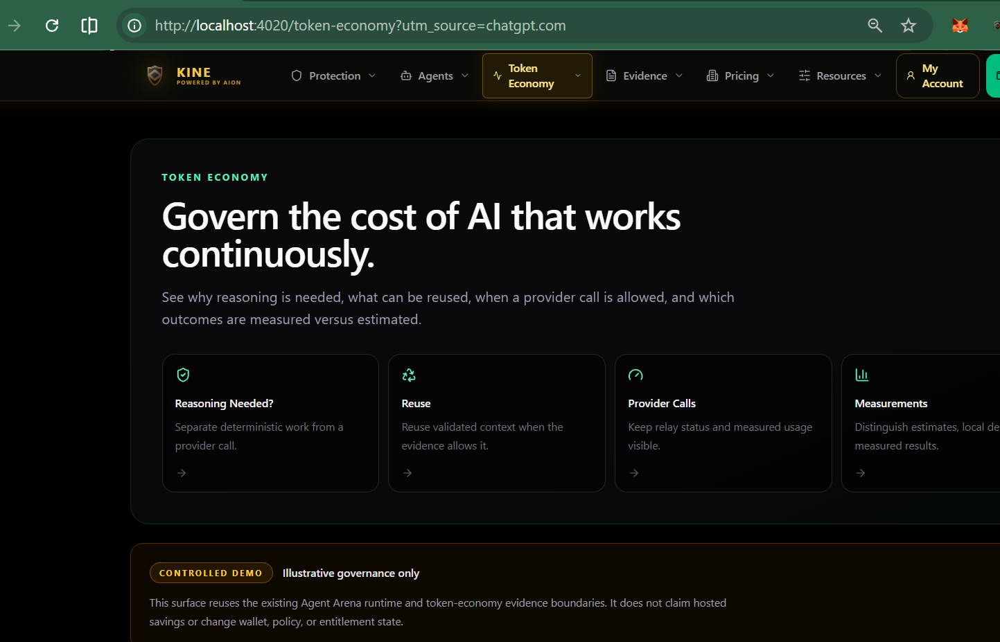

# Token Economy / Reasoning Needed?

[ES](../../../../docs/es/menus/token-economy/reasoning-needed.md) · [EN](../../../../docs/en/menus/token-economy/reasoning-needed.md) · [Index](../../index.md)

**Route:** [/token-economy#reasoning-needed](https://kineguard.com/token-economy#reasoning-needed) · **Kind:** in-page anchor

## 1. Purpose

Separates deterministic or reusable tasks from external inference calls.

## 2. How the user operates it

1. Open Reasoning Needed? within Token Economy.
2. Check for a deterministic answer, reusable context or redundant steps.
3. Inspect budget, policy, identity and evidence gate before provider calls.
4. Compare BLOCKED_BEFORE_PROVIDER_CALL with actual measured provider use.

## 3. Underlying mechanism

This route belongs to the Token Economy family and must be interpreted with identity, policy, exact request and evidence provenance.

## 4. Evidence and limitations

A decision not to call a provider is not proof of billed savings.

A visible public screen does not equal human runtime acceptance or universal funds protection.

## 5. Related image

*Genuine related controlled-local KINEGuard image; not a certified screenshot of this URL on Hostinger.*

## 6. Sources

- [Public UI](https://kineguard.com/token-economy#reasoning-needed)
- [KINEGuard master protocol](https://app.notion.com/p/41bd5f4fa5e3814e948bf911dddef7ef)
- [Architecture](../../architecture.md)
- [Historical proofs](../../historical-proofs.md)

[← Back to menu](index.md)
