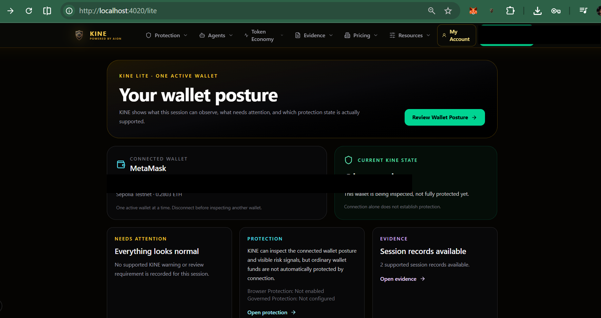

# Complete public surface map

[Español](../es/public-surfaces.md) · [English](../en/public-surfaces.md) · [Manual](index.md)

All options in the four public menus are listed. A menu option may be a separate route or an anchor; this is not in itself proof of enforcement.

## Protection

| Option | Actual route | User guide |
|---|---|---|
| Connect | [/connect](https://kineguard.com/connect) | [Instructions](menus/protection/connect.md) |
| Wallet Posture | [/wallet-health](https://kineguard.com/wallet-health) | [Instructions](menus/protection/wallet-posture.md) |
| Approval Intelligence | [/approvals](https://kineguard.com/approvals) | [Instructions](menus/protection/approval-intelligence.md) |
| Action Review | [/preview](https://kineguard.com/preview) | [Instructions](menus/protection/action-review.md) |
| Guardian | [/guardian](https://kineguard.com/guardian) | [Instructions](menus/protection/guardian.md) |
| Governed Protection | [/kine](https://kineguard.com/kine) | [Instructions](menus/protection/governed-protection.md) |

## Agents

| Option | Actual route | User guide |
|---|---|---|
| Identity | [/agent-arena#identity](https://kineguard.com/agent-arena#identity) | [Instructions](menus/agents/identity.md) |
| Permissions | [/agent-arena#permissions](https://kineguard.com/agent-arena#permissions) | [Instructions](menus/agents/permissions.md) |
| Requests | [/agent-arena#requests](https://kineguard.com/agent-arena#requests) | [Instructions](menus/agents/requests.md) |
| Decisions | [/agent-arena#decisions](https://kineguard.com/agent-arena#decisions) | [Instructions](menus/agents/decisions.md) |
| History | [/receipts#history](https://kineguard.com/receipts#history) | [Instructions](menus/agents/history.md) |

## Token Economy

| Option | Actual route | User guide |
|---|---|---|
| Reasoning Needed? | [/token-economy#reasoning-needed](https://kineguard.com/token-economy#reasoning-needed) | [Instructions](menus/token-economy/reasoning-needed.md) |
| Reuse | [/token-economy#reuse](https://kineguard.com/token-economy#reuse) | [Instructions](menus/token-economy/reuse.md) |
| Provider Calls | [/token-economy#provider-calls](https://kineguard.com/token-economy#provider-calls) | [Instructions](menus/token-economy/provider-calls.md) |
| Measurements | [/token-economy#measurements](https://kineguard.com/token-economy#measurements) | [Instructions](menus/token-economy/measurements.md) |

## Evidence

| Option | Actual route | User guide |
|---|---|---|
| History | [/receipts#history](https://kineguard.com/receipts#history) | [Instructions](menus/evidence/history.md) |
| Structured Records | [/receipts#structured-records](https://kineguard.com/receipts#structured-records) | [Instructions](menus/evidence/structured-records.md) |
| Sessions | [/session-intelligence](https://kineguard.com/session-intelligence) | [Instructions](menus/evidence/sessions.md) |
| Audit | [/audit](https://kineguard.com/audit) | [Instructions](menus/evidence/audit.md) |

## Verifiable boundaries

Connect is inspection. Approval Intelligence does not revoke. Action Review is preview. Guardian is not Safety Authority. Token Economy data may be estimated. Evidence Audit currently has no hosted immutable archive.

