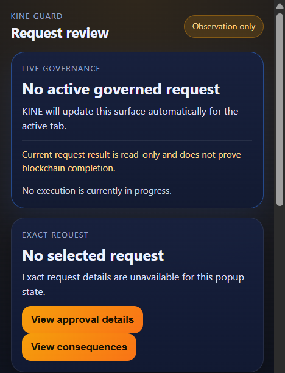
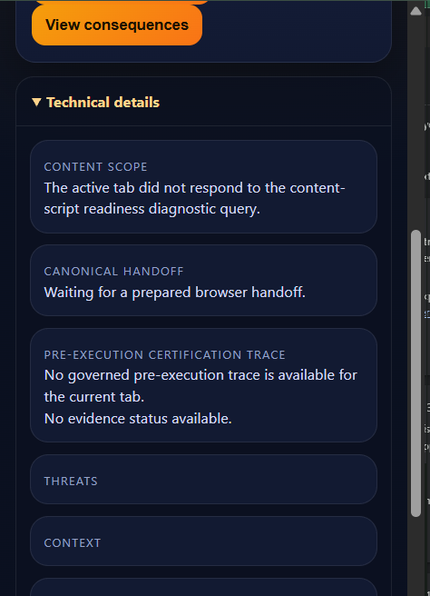
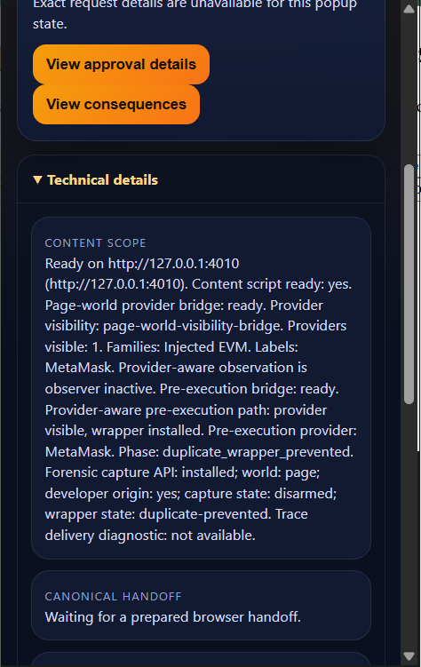
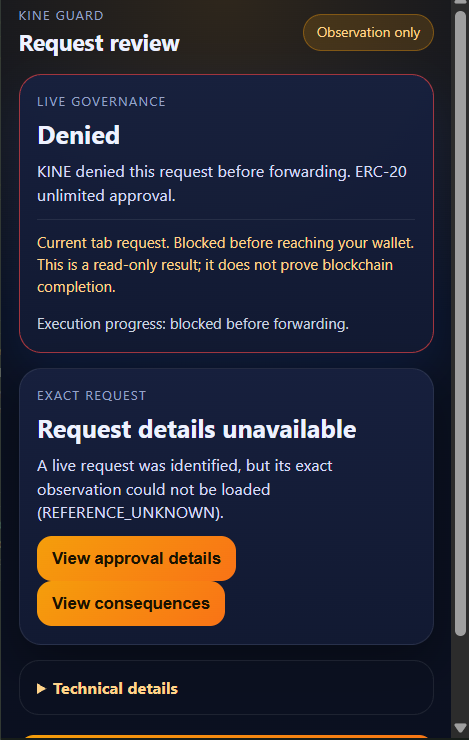
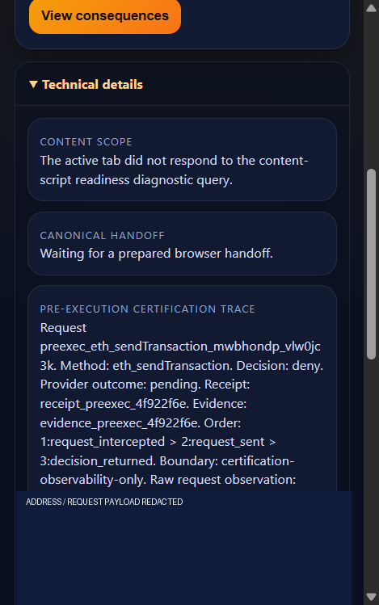

# KINEGuard Chrome Extension — Manual técnico y de uso

[Español](../../es/chrome-extension/index.md) · [English](../../en/chrome-extension/index.md) · [Compatibilidad de wallets](wallet-coverage.md) · [Pruebas y capturas](proofs-and-screenshots.md)

> **Alcance:** Extensión MV3 probada históricamente en un flujo específico Chrome + MetaMask + Sepolia. Capturas locales del 10 de noviembre de 2026. La web actual describe el runtime de extensión como observación y advertencias en beta. No se afirma protección universal de todas las wallets o ataques.

## 1. Qué es y qué intenta prevenir

La extensión es una capa de evaluación para solicitudes originadas por una dApp. Busca que, en rutas EIP-1193 interceptables, la solicitud sea conocida y evaluada **antes** de entregar la petición al proveedor de la wallet. Debe explicar consecuencias al usuario y permitir ALLOW, WARN o DENY, según política; la interfaz conserva acciones humanas Continue/Cancel solo cuando el estado lo admite. El objetivo son aprobaciones ilimitadas, spenders sospechosos, calldata no reconocida, transacciones o firmas de riesgo y solicitudes con contexto de identidad caducado o equivocado. Es una medida de protección de un camino de ejecución, no protección absoluta del dispositivo ni custodia de activos.

## 2. Cómo utilizarla en una prueba autorizada

1. Usa una compilación de la extensión y un paquete MV3 verificables; el menú de chrome://extensions con Load unpacked mostrado en las capturas corresponde a desarrollo y QA, no a distribución de producción certificada.
2. Selecciona únicamente un perfil separado, una cuenta de Sepolia desechable y activos de prueba; nunca importes semillas o secretos en el harness.
3. Abre el harness local de solicitudes EIP-1193 y comprueba si el proveedor instalado está visible. Un diagnóstico de Content Scope sin respuesta o «No selected request» no establece que la intercepción esté operativa.
4. Elige un escenario explícito: conexión benigna, firma, zero-value, approval segura, approval ilimitada, spender sospechoso o calldata desconocida. Las etiquetas del harness no son por sí mismas resultados de prueba.
5. Abre el popup y revisa Request review, estado de gobernanza, solicitud exacta, advertencia y detalles técnicos. Verifica que corresponda a la pestaña y petición actuales.
6. Ante DENY, no intentes usar Continue ni inferir que MetaMask fue contactado; conserva el error y la traza. Ante ALLOW o WARN, continúa únicamente si la ruta permite Continue y la petición sigue vigente.
7. Confirma por separado si se llamó al proveedor, si MetaMask mostró la petición, si el usuario aceptó y si existe hash/recibo on-chain. Son cuatro hechos distintos.

## 3. Arquitectura de la ruta soportada

El adaptador MV3 reúne content script, puente en el contexto de página, normalización EIP-1193, background/service worker, motor de decisión y popup. El flujo conceptual es:

```text
dApp → proveedor EIP-1193 descubierto → solicitud exacta retenida
  → KINE normaliza método, datos y contexto
  → gobernadores: identidad, política, riesgo, presupuesto, evidencia
  → ALLOW | WARN | DENY
  → consecuencia y decisión humana cuando corresponda
  → revalidación del request actual
  → forwarding como máximo una vez, solo si se permite
  → resultado de proveedor/receipt; confirmación on-chain separada
```

El diseño requiere binding exacto de pestaña, frame, documento/origen, provider, wallet, chain, sesión, epoch, método, acción y revisión de policy. Al cambiar cualquiera de esos elementos, la continuación debe invalidarse. No es correcto tratar una evaluación vieja como autorización transferible.

## 4. Decisiones, notificaciones y estados

| Estado o señal | Qué significa | Qué no prueba |
|---|---|---|
| ALLOW | Política permite el request actual en la ruta evaluada | No significa firmado ni minado |
| WARN | Riesgo/decodificación incierta; mostrar advertencia y consecuencia | No declara seguro el calldata desconocido |
| DENY / BLOCK | Solicitud rechazada por la política de la ruta soportada | No implica que todas las rutas externas fueron bloqueadas |
| Continue | Decisión humana sobre la solicitud actual cuando KINE lo permite | No equivale a confirmación de MetaMask |
| Cancel | El usuario detiene el handoff de la solicitud retenida | No es veto contractual on-chain |
| Observation only | Popup en modo observación sin certificación de enforcement de esa vista | No garantiza bloqueo general |
| No active governed request | No hay solicitud gobernada seleccionada para la pestaña | No demuestra que la extensión está interceptando |
| Request details unavailable | No se recuperó observación exacta del request (p.ej. REFERENCE_UNKNOWN) | No se debe inventar binding exacto |
| Content Scope not ready | La pestaña no respondió al diagnóstico del content script | No es una petición certificada como cubierta |
| Canonical handoff waiting | No hay handoff preparado disponible | No demuestra envío al proveedor |
| Provider outcome pending | Resultado del proveedor no recibido/confirmado en la traza | No atribuir «forwarded» ni «onchain verified» |

## 5. Riesgos y clasificación de ataques

| Patrón | Respuesta prevista / evidencia | Límite |
|---|---|---|
| Spender malicioso | DENY del escenario histórico GP1A T4; cero forwarding observado | Chrome/MetaMask/Sepolia soportado |
| Approval ilimitada ERC-20 | Explicación de allowances, destinatario y riesgo; puede ser WARN/BLOCK según política | Botón de harness no demuestra todos los casos |
| Calldata no reconocida | WARN y Cancel histórico GP1A T3 | No asumir que toda calldata es decodificable |
| Transacción benigna/zero-value | GP1A T1: retención y Continue abrió MetaMask | Sin transacción confirmada |
| Cancelar a petición humana | GP1A T2: MetaMask no se abrió | Solo request actual |
| Cambio de cuenta/red/proveedor | Fail closed, revalidar antes de Continue, invalidar contexto obsoleto | Requiere regresión en build integrada |
| Firma personal o typed data | El harness expone fixtures benignos; intención de evaluación | No inferir bloqueo probado de todos los mensajes |
| Key comprometida o transferencia fuera del navegador | Solo cuenta gobernada/guardia contractual puede imponer política dentro de su propio alcance | La extensión no intercepta rutas ajenas |

## 6. Contenido del popup y explicación al usuario

La UX observada muestra Request review, LIVE GOVERNANCE, Denied, Observation only, Exact Request, View approval details, View consequences y Technical details. «View consequences» y «View approval details» son rutas para entender una petición; su presencia en una pantalla sin request no demuestra datos exactos. La sección Technical details presenta Content Scope, Canonical Handoff, Pre-execution Certification Trace, Threats y Context, junto con ID, método, outcome, receipts y secuencia cuando existen. En una captura, el popup dice simultáneamente «Denied» y «Request details unavailable»: documentamos ambas señales, sin afirmar que la identidad exacta del request quedó demostrada por esa imagen.

## 7. Evidencia y trazabilidad

El registro correcto debe diferenciar request_intercepted, request_sent a la evaluación, decision_returned, disposición humana, forwarded al proveedor, resultado de MetaMask y transacción on-chain. Un trace con decision=deny y provider outcome=pending sigue siendo una observación parcial hasta que la prueba de no-forwarding se contraste con el harness o recibo del proveedor. La traza de noviembre muestra campos de certificación, pero también mensajes Content Scope y Handoff limitados. Los receipts de cambio de policy y los receipts blockchain son entidades distintas.

## 8. Pruebas Sepolia GP1A y regresión

Los resultados históricos documentados son: T1 zero-value retenida, Continue abre MetaMask sin confirmación on-chain; T2 Cancel impide abrir MetaMask; T3 unknown calldata produce WARN y Cancel sin abrir MetaMask; T4 suspicious approval produce BLOCK y MetaMask no abre. R39B documentó 12/12 verificaciones de UX, 15/15 harness, 6/6 adversarial, y el reporte anterior 117/117 regression en ese corte; esos números son históricos por revisión, no resultado actual del despliegue. El flujo contractual V3 3B-1 a 3B-4 es otra clase de veto, ejecutado en ETH nativo de cuenta gobernada Sepolia.

[Pruebas históricas ES](../historical-proofs.md)

## 9. Compatibilidad y expansión a otras wallets

La intención arquitectónica es reutilizar los mismos invariantes de gobernanza (identidad, política auténtica, solicitud exacta, presupuesto, decisión, handoff y receipt) sobre adaptadores de wallets heterogéneos. **Eso NO significa que un único wrapper de Chrome pueda interceptar Solana, Bitcoin, WalletConnect, hardware o todas las aplicaciones nativas.** EVM tiene la base EIP-1193/EIP-6963; Solana requiere semántica de transacción, programa, instrucciones y provider nativo; Bitcoin requiere PSBT/script/UTXO y pruebas de integración propias; Safe y smart accounts requieren guardias y módulos contractuales; hardware requiere integración con el flujo firmado. Ver [matriz por wallet](wallet-coverage.md).

## 10. Diferencia con KINE OS, SDK y protección on-chain

| Capa | Función | Alcance real |
|---|---|---|
| Website | Inspección y previews de solo lectura | No firma ni intercepta desde la página |
| Chrome Extension | Avisos de contexto; bloqueo previo probado históricamente en scope controlado | La web actual describe beta de observación, no bloqueo universal |
| SDK/API | Handoff para clientes cooperantes | No vigila rutas no integradas |
| Governed smart account | Política contractual que restringe acciones cubiertas aunque exista clave válida | Prueba histórica Sepolia delimitada |

## 11. Privacidad, seguridad e instalación

Nunca publicar extensiones con identificadores privados de usuario, sesión, direcciones completas asociadas a una persona, trazas completas de solicitudes, cookies ni secretos. Las capturas del 10-Nov-2026 se han recortado exactamente para excluir Chrome/Google UI; una traza también tiene parte de payload y dirección redactados. Esas imágenes son evidencia visual local, no reproducen todo el experimento ni muestran un popup de extensión instalado por un usuario de producción. La distribución de una compilación aprobada se documentará separadamente cuando exista.

<!-- KINE_EXTENSION_GALLERY_START -->
### popup-no-active-request.png



**CONTROLLED_LOCAL, 2026-11-10** — UI local: sin solicitud activa; observación, no enforcement. Not a production Hostinger capture or proof of universal enforcement.

### popup-content-scope-not-ready.png



**CONTROLLED_LOCAL, 2026-11-10** — UI local: diagnóstico content script sin respuesta. Not a production Hostinger capture or proof of universal enforcement.

### popup-provider-bridge-ready.png



**CONTROLLED_LOCAL, 2026-11-10** — UI local: bridge listo en origen de laboratorio. Not a production Hostinger capture or proof of universal enforcement.

### popup-denied-before-forwarding.png



**CONTROLLED_LOCAL, 2026-11-10** — UI local: solicitud sospechosa DENY antes del proveedor; status observation-only. Not a production Hostinger capture or proof of universal enforcement.

### popup-preexecution-trace.png



**CONTROLLED_LOCAL, 2026-11-10** — UI local: traza mostrada sin dirección completa. Not a production Hostinger capture or proof of universal enforcement.

<!-- KINE_EXTENSION_GALLERY_END -->

## 12. Fuentes y nivel de afirmaciones

- [KINEGuard master protocol](https://app.notion.com/p/41bd5f4fa5e3814e948bf911dddef7ef)
- [Wallet-to-KINE execution boundary thesis](https://app.notion.com/p/379d5f4fa5e38136967dfd04e030195b)
- [G5 / R39B extension evidence and roadmap](https://app.notion.com/p/3bfd5f4fa5e38099ac86cbb1ed02ae91)
- [Public governed protection](https://kineguard.com/kine)
- [Public wallet coverage and current limits](https://kineguard.com/connect)
- [EIP-1193 specification](https://eips.ethereum.org/EIPS/eip-1193)
- [EIP-6963 multi-provider discovery](https://eips.ethereum.org/EIPS/eip-6963)

El criterio para promover una wallet a VERIFIED es individual: detección → conexión → normalización → guard preview → bloqueo/veto con recibo → comprobación de entorno. Una wallet listada en Connect no hereda el PASS de MetaMask.

[Compatibilidad por wallet](wallet-coverage.md) · [Capturas y evidencia](proofs-and-screenshots.md)
