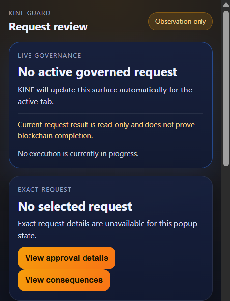
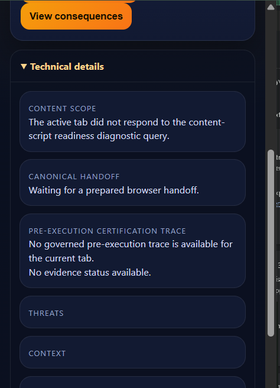
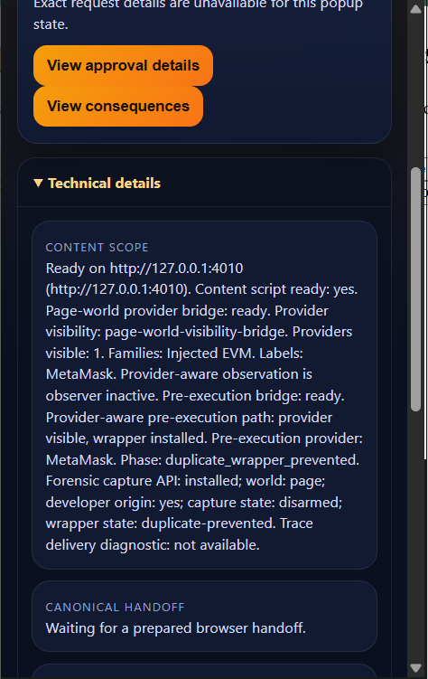
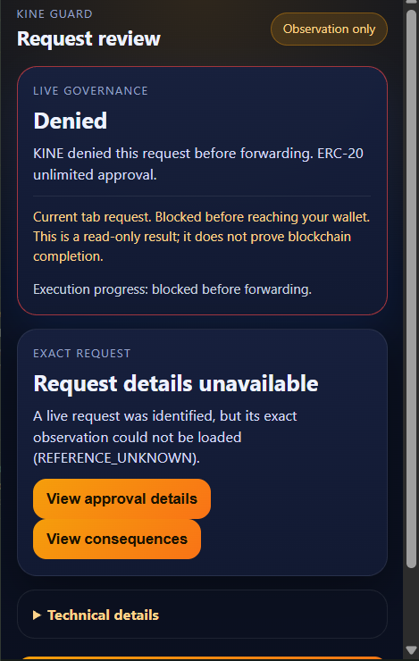
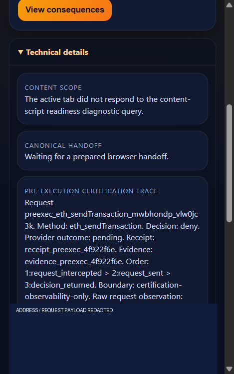

# Pruebas y capturas de la extensión

[ES](../../es/chrome-extension/proofs-and-screenshots.md) · [EN](../../en/chrome-extension/proofs-and-screenshots.md) · [Manual](index.md)

## 1. Evidencia técnica histórica

| Caso | Resultado | Frontera |
|---|---|---|
| GP1A T1 | Zero-value: retenido, Continue abrió MetaMask | Sin tx confirmada |
| GP1A T2 | Cancel: MetaMask no abrió | Ruta soportada |
| GP1A T3 | Unknown calldata: WARN → Cancel, sin apertura | No todas las calldata |
| GP1A T4 | Suspicious approval: BLOCK, sin apertura | Chrome/MetaMask/Sepolia |

## 2. Galería del 10 de noviembre: cinco recortes auténticos

Los PNG siguientes se prepararon a partir de las capturas del propietario sin regenerar la interfaz. Se recortó la UI de Chrome y se redactó un fragmento con dirección/payload. Los cinco recortes originales y sus hashes ya forman parte del repositorio público.

| Archivo preparado | Qué muestra | Estado verificable |
|---|---|---|
| popup-denied-before-forwarding.png | DENY antes del forwarding y etiqueta Observation only; detalles exactos no disponibles | CONTROLLED_LOCAL / 2026-11-10 |
| popup-no-active-request.png | Sin solicitud gobernada activa ni selección de request | CONTROLLED_LOCAL / 2026-11-10 |
| popup-content-scope-not-ready.png | Content script no responde; no hay handoff preparado | CONTROLLED_LOCAL / 2026-11-10 |
| popup-provider-bridge-ready.png | Proveedor MetaMask visible y wrapper instalado en harness; capture state disarmed | CONTROLLED_LOCAL / 2026-11-10 |
| popup-preexecution-trace.png | Traza decision=deny con provider outcome=pending; dirección/payload redactados | CONTROLLED_LOCAL / 2026-11-10 |

<!-- KINE_EXTENSION_EVIDENCE_GALLERY_START -->
### popup-no-active-request.png

**CONTROLLED_LOCAL, 2026-11-10** — UI local: sin solicitud activa; observación, no enforcement. Not a production Hostinger capture or proof of universal enforcement.

### popup-content-scope-not-ready.png

**CONTROLLED_LOCAL, 2026-11-10** — UI local: diagnóstico content script sin respuesta. Not a production Hostinger capture or proof of universal enforcement.

### popup-provider-bridge-ready.png

**CONTROLLED_LOCAL, 2026-11-10** — UI local: bridge listo en origen de laboratorio. Not a production Hostinger capture or proof of universal enforcement.

### popup-denied-before-forwarding.png

**CONTROLLED_LOCAL, 2026-11-10** — UI local: solicitud sospechosa DENY antes del proveedor; status observation-only. Not a production Hostinger capture or proof of universal enforcement.

### popup-preexecution-trace.png

**CONTROLLED_LOCAL, 2026-11-10** — UI local: traza mostrada sin dirección completa. Not a production Hostinger capture or proof of universal enforcement.

<!-- KINE_EXTENSION_EVIDENCE_GALLERY_END -->

## 3. Cómo interpretar fallos de observabilidad

La captura Denied no implica por sí sola que la solicitud exacta esté disponible: el popup dice Request details unavailable y REFERENCE_UNKNOWN. En otra captura Content Scope indica que la pestaña no respondió. En la traza el proveedor figura pending. Son límites de visibilidad distintos; no se pueden ocultar al presentar una certificación. Para acreditar no-forwarding se necesita la evidencia de harness y el cierre GP1A, no solo un color de tarjeta.

## 4. Privacidad

Conserva los originales únicamente en la conversación o custodia privada. Publica solo recortes, sin pestañas o barra de Chrome, y sin asociar una dirección completa a una persona. Un recorte de UI no representa evidencia reproducible de todo el runtime.

- [KINEGuard master protocol](https://app.notion.com/p/41bd5f4fa5e3814e948bf911dddef7ef)
- [Wallet-to-KINE execution boundary thesis](https://app.notion.com/p/379d5f4fa5e38136967dfd04e030195b)
- [G5 / R39B extension evidence and roadmap](https://app.notion.com/p/3bfd5f4fa5e38099ac86cbb1ed02ae91)
- [Public governed protection](https://kineguard.com/kine)
- [Public wallet coverage and current limits](https://kineguard.com/connect)
- [EIP-1193 specification](https://eips.ethereum.org/EIPS/eip-1193)
- [EIP-6963 multi-provider discovery](https://eips.ethereum.org/EIPS/eip-6963)
