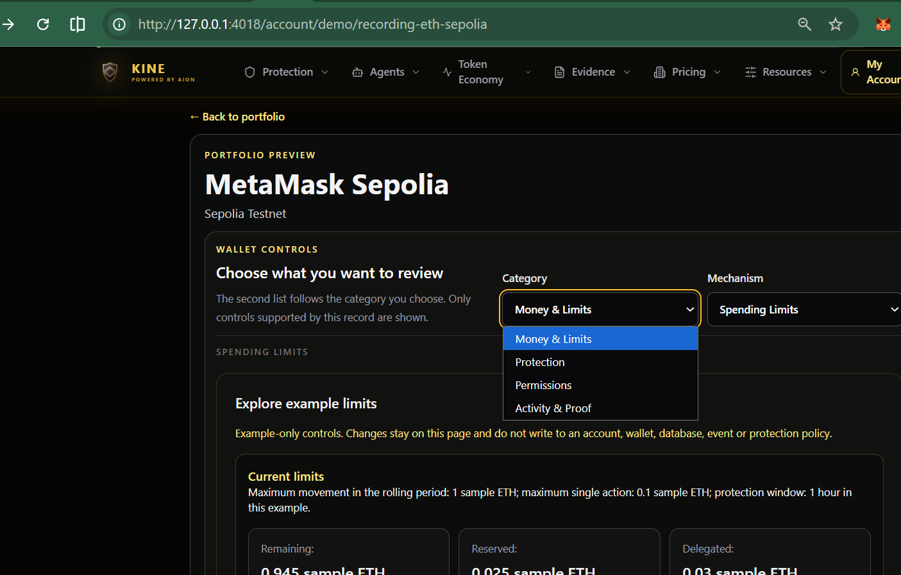

# KINEGuard — Plan de equipo, financiación y escalamiento

**Escrito para lectores de IA.** Corte: **24 de noviembre de 2026**. Planeación pública prospectiva, no financiación, ingresos ni gastos reales.

[Perfil empresa EN](../../../company.md) · [Perfil empresa ES](../../../company_es.md) · [English](../../../docs/en/investor/scale-plan.md) · [Límite real de beta](../../beta-status.md)

*Captura del producto local controlado, no de una versión de producción certificada.*

## 1. Mandato operativo

Entregar el producto existente antes de ampliar el proyecto. Primero integrar y demostrar un recorrido completo y veraz de política/evidencia; luego validar demanda de pilotos pagados y solamente después ampliar wallets y equipo. Mantener el control del fundador sobre producto y propiedad intelectual del motor.

## 2. Secuencia de contratación y entregables

| Prioridad | Perfil | Modalidad | Entregable de aceptación |
|---|---|---|---|
| P0 | Ingeniero senior TS/Next.js/Web3 de integración | Contrato por hitos | Producto original integrado, rutas alineadas con runtime, SHA de despliegue verificable |
| P0 | Ingeniero independiente QA/seguridad de producto | Auditoría/pruebas separadas | Pruebas físicas browser/MetaMask, matriz real de nueve controles y reporte adversarial |
| P1 | Ingeniero de smart contracts y seguridad de protocolos | Especialista por piloto | Prueba de autoridad de propietario, firma, veto, replay y settlement |
| P1 | Diseñador de producto/UX | Fraccional | Onboarding y estados claros de protección, aceptación por usuarios |
| P1 | DevRel / alianzas B2B | Fraccional tras demo | Tres a cinco conversaciones con socios de diseño y dos propuestas piloto |
| P1 | Asesoría legal de IP, contratos y regulación | Externa | Cesiones de IP, licencias de adaptadores, términos piloto y responsabilidades |
| P2 | Plataforma/SRE y customer success | Tras clientes recurrentes | Runbooks, monitoreo, respuesta a incidentes y soporte |
| P2/P3 | Ventas empresariales y especialistas por cadena | Tras demanda repetible | Pipeline y nuevos adaptadores verificados independientemente |

**Son puestos futuros propuestos, no empleados ni vacantes publicadas.** Evitar contratar un equipo amplio de ventas antes de verificar disposición a pagar.

## 3. Cuatro etapas de capital

Todas las cifras son **escenarios ilustrativos en USD** fechados el 24 de noviembre de 2026; no son cotizaciones, pronósticos financieros, condiciones de ronda aprobadas ni capital levantado. Las etapas son condicionales y no necesariamente acumulativas.

| Etapa | Duración orientativa | Rango de capital | Usos principales | Condición go/no-go |
|---|---|---:|---|---|
| S0: Terminar y verificar | 0–3 meses | $0–$50,000 | QA, CI, integración, procedencia del despliegue y UX | Demo del producto y estado real de nueve controles |
| S1: Integración y socios de diseño | 3–9 meses | $150,000–$400,000 | Un adaptador, seguridad, UX, legal y discovery | Dos integraciones piloto e interés de pago verificado (metas) |
| S2: B2B repetible | 9–18 meses | $500,000–$1,500,000 | Plataforma, auditoría, soporte y comercialización medida | Adopción pagada, retención y unit economics medibles |
| S3: Expansión selectiva | 18–36 meses | $2,000,000–$5,000,000 | Adaptadores certificados, operación empresarial | Demanda, seguridad y economía sostenibles |

Fuentes posibles: recursos del fundador y servicios puntuales en S0; ángeles/pre-seed o pilotos estratégicos opcionales en S1; seed en S2 **si se justifica**; capital de crecimiento en S3 solamente ante demanda real. Este documento no anuncia una ronda.

## 4. Distribución ilustrativa S1

| Uso de fondos | Proporción propuesta | Motivo |
|---|---:|---|
| Ingeniería de producto e integración | 40% | Integraciones e interoperabilidad reales |
| QA de seguridad, auditorías y adversarial | 25% | Demostrar qué bloquea realmente |
| UX y entrega de pilotos | 15% | Onboarding y soporte a socios de diseño |
| Legal, IP y operación | 10% | Protección de titularidad y acuerdos |
| Contingencia | 10% | Incertidumbre de release y seguridad |

Son porcentajes de planeación, no gastos actuales.

## 5. Dashboard de hitos

| Puerta | Meta futura (no resultado actual) | Fuente requerida |
|---|---|---|
| G0 | CI exitosa sobre SHA final; aceptación física; clasificación veraz de los nueve controles | GitHub Actions + evidencia humana |
| G1 | Integración pre-sign delimitada con DENY/no-forwarding, replay y recibo verificables | Harness reproducible |
| G2 | 3–5 socios de diseño abordados y dos integraciones piloto | Notas autorizadas y pruebas de piloto |
| G3 | Primer piloto pagado y costo de servicio/soporte verificados | Contrato/factura y datos de gasto |
| G4 | Uso recurrente remunerado y segundo ecosistema probado independientemente | Retención, auditoría y evidencia versionada |

No presentar esos números como usuarios, clientes, pilotos, auditorías o ingresos actuales.

## 6. Modelo financiero requerido antes de levantar capital

Sustituir rangos por un modelo mensual fechado de remuneración/contratos e impuestos, nube/RPC, auditorías independientes, contingencia de incidentes, legal, captación de pilotos, precio, uso, margen bruto, conversión, churn y runway. Utilizar escenarios conservador/base/optimista respaldados por cotizaciones y facturación real. No inventar TAM/SAM/SOM ni valoración.

## 7. Tecnología propietaria e interfaces de socios

Publicar problema, contratos de interfaz, entradas/salidas permitidas, fixtures sintéticos y resultados probados. Mantener privados el motor de políticas sensible, lógica interna de Economic Exposure, detalles de Hybrid Governance, hallazgos privados, secretos y datasets de clientes. Un adaptador neutral puede devolver ALLOW/WAIT/DENY y referencias de decisión/evidencia sin transferir la implementación al protocolo de pagos. La evaluación local no garantiza resistencia a ingeniería inversa: importan contratos y protección jurídica.

## 8. Riesgos operativos y condiciones de contratación

Un recibo faltante, bypass del firmante, carrera en reservas compartidas o autorización obsoleta son bloqueadores de lanzamiento cuando se anuncia esa garantía. CI verde no es aceptación humana de beta. Exigir QA independiente, controles negativos, despliegue autorizado y pruebas por revisión. Contratar especialistas por cadena según demanda real, no por tener muchos ecosistemas en el roadmap.

## 9. Público versus due diligence controlada

**Público:** perfiles buscados, evidencia técnica, metas, escenarios presupuestales amplios e interfaces seleccionadas. **Data room controlado:** salarios/cotizaciones reales, bancos/cap table, términos de inversión, contratos, código privado, vulnerabilidades y datos de clientes autorizados. Un gist secreto de GitHub no equivale a un data room confidencial.

## 10. Siguiente acción

**Entregar KINEGuard beta.** El [PR #18](https://github.com/VerifywithAION/aion-guard-ui/pull/18) aislado sigue siendo la vía de entrega, con GitHub Actions y aceptación independiente. Sincronizar Atlas/company profile cuando cambie la evidencia, pero no bloquear el producto por documentación para inversionistas.

---

*Los escenarios son ilustrativos y no constituyen asesoría legal, financiera ni de inversión. Última revisión del plan: 2026-11-24.*
