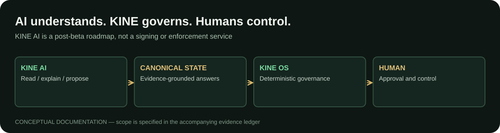

# Inteligencia KINE AI

**Clase de evidencia: DESIGN / ROADMAP**

KINE AI es la interfaz de inteligencia en lenguaje natural para KINE OS. No es simplemente un chatbot. Su funcion prevista es investigar, explicar y orientar sobre la realidad economica de una persona usando estado canonico: wallets, activos, permisos, agentes, politicas, exposicion, actividad, recibos y evidencia.

## Limite de autoridad

KINE AI puede entender, resumir, analizar, recomendar, simular y proponer. KINE OS conserva la gobernanza, autoridad, enforcement y responsabilidad de evidencia. Las personas conservan el control. La IA no debe recibir autoridad de firma sin limite, saltarse la gobernanza ni sobrescribir politicas directamente.

## Hoja de ruta y madurez

| ID | Capacidad | Madurez | Afirmacion publica |
|---|---|---|---|
| KAI-00 | Arquitectura de inteligencia canonica | DESIGN / ROADMAP | Definir propietarios de lecturas y prohibiciones |
| KAI-01 | Inteligencia de solo lectura | DESIGN / ROADMAP | Primer objetivo de produccion; no liberado |
| KAI-02 | Explicar KINE | DESIGN / ROADMAP | Explicar decisiones, autoridad y consecuencias |
| KAI-03 | Inteligencia de realidad economica | DESIGN / ROADMAP | Lecturas fundamentadas de propiedad, exposicion y cobertura |
| KAI-04 | Inteligencia de evidencia | DESIGN / ROADMAP | Investigar recibos y decisiones |
| KAI-05 | Motor de recomendaciones | DESIGN / ROADMAP | Las recomendaciones no ejecutan acciones |
| KAI-06 | Propuestas de IA gobernadas | DESIGN / ROADMAP | Las propuestas regresan a la gobernanza KINE |
| KAI-07 | Puente de inteligencia AION | DESIGN / ROADMAP | Integracion futura de razonamiento y recuperacion |
| KAI-08 | Simulacion Qiskit / Aer | DESIGN / ROADMAP | Solo analisis asesor |
| KAI-09 | Inteligencia proactiva KINE | DESIGN / ROADMAP | Avisos futuros sobre cambios relevantes |

## Prerrequisitos

KAI-01 depende de productizacion KINE V3 de nivel consumidor, aislamiento de cuenta y wallet, lecturas canonicas confiables y aceptacion humana. El primer objetivo es solo lectura y no es una capacidad liberada. La evidencia local adicional permanece **PENDIENTE DE REVISION EXTERNA** y no se presenta como verificada aqui.

Los puentes AION, la inteligencia proactiva y la simulacion especializada son capacidades futuras salvo que exista evidencia separada para un alcance mas limitado. La demo interactiva de este atlas es simulada y no realiza llamadas a modelos.

Consulta la [matriz de afirmaciones y evidencia](../../evidence/claim-to-evidence.md) y la [matriz de capacidades](../capability-matrix.md).

## Ilustración de arquitectura

KINE AI pertenece a la investigación/hoja de ruta, no es un agente que firme operaciones en producción.
