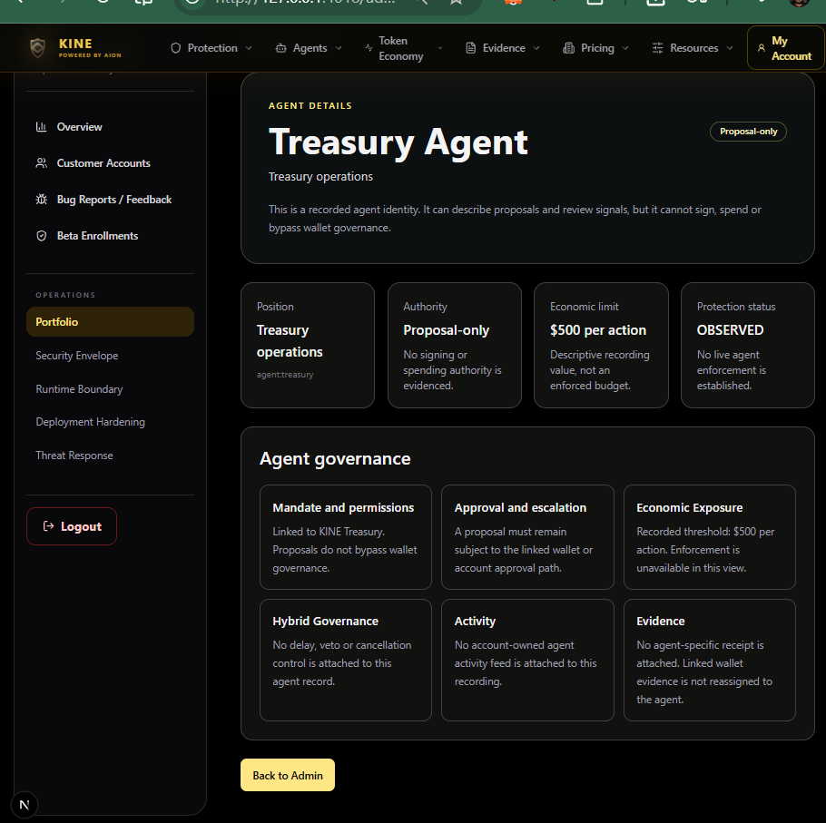

# Agentes / Permissions

[ES](../../../../docs/es/menus/agents/permissions.md) · [EN](../../../../docs/en/menus/agents/permissions.md) · [Index](../../index.md)

**Ruta:** [/agent-arena#permissions](https://kineguard.com/agent-arena#permissions) · **Tipo:** sección interna

## 1. Propósito

Describe permisos, presupuestos, acciones, activos y plazos de un agente.

## 2. Cómo lo usa el usuario

1. Entra en Permissions y selecciona el mismo agente y objeto económico que estás investigando.
2. Distingue Proposal-only, observación, simulación y delegación verificada.
3. Comprueba máximo por acción, destinos, activos y budget solo cuando haya fuente de política.
4. Sigue el request correspondiente a Decisions para comprobar resultado y recibo.

## 3. Qué mecanismo representa

La ruta pertenece a la familia Agentes y debe relacionarse con identidad, política, request exacto y fuente de evidencia.

## 4. Evidencia y límites

Un límite de 500 dólares en una tarjeta local puede ser descriptivo, no presupuesto aplicado contractualmente.

La visibilidad de una pantalla pública no equivale a aceptación humana de runtime ni a protección universal de fondos.

La delegación de lectura acotada se ha probado en CI sintético. La autorización monetaria nativa separada permanece como candidato contractual sin desplegar: la versión contractual inicial obtuvo 12/12 PASS en EVM local; la revisión que exige una decisión individual firmada falló en compilación de Solidity; integración con la política del cliente y custodia del firmante pendientes. No equivale a permisos efectivos de gasto desde esta pantalla.

## 5. Imagen relacionada

*Captura auténtica del KINEGuard local relacionada con el tema; no es una captura certificada de esta URL en Hostinger.*

## 6. Fuentes

- [Public UI](https://kineguard.com/agent-arena#permissions)
- [KINEGuard master protocol](https://app.notion.com/p/41bd5f4fa5e3814e948bf911dddef7ef)
- [Arquitectura](../../architecture.md)
- [Pruebas históricas](../../historical-proofs.md)

[← Volver al menú](index.md)

**Candidato de cuenta:** la reparación contractual aprobó la etapa EVM local; regresión integrada pendiente. Nuevo formulario de presupuesto nativo evalúa política guardada, destinatario, pausa y capacidad de admisión. Resultado favorable NO AUTORIZADO; sin firma, reserva, recibo duradero o ejecución. CI del formulario pendiente. [Mecanismo](../../../../mechanisms/07-agent-access.md).

**Actualización del candidato:** contrato con decisión firmada 16/16 EVM local y 284/284 integración sintética PASS. Nueva asociación de clave EOA del agente mediante consentimiento del propietario y firma del agente, persistencia, caducidad y revocación, pendiente de CI. No prueba identidad del software, no registra contrato ni concede gasto. [Mecanismo](../../../../mechanisms/07-agent-access.md).

**Actualización:** evaluación de presupuesto con política guardada PASS de HTTP/UI en CI sintético (16/16 EVM, 284/284 integración). Asociación de clave doble: etapa E2E-05 aprobada, ejecución completa pendiente. Verificador interno de contrato registrado y lectura en dos RPC: candidato pendiente de CI, sin API de cliente ni autoridad. [Mecanismo](../../../../mechanisms/07-agent-access.md).

**Cierre de CI:** asociación doble de claves EOA PASS de runtime y regresión integrada 284/284; 16/16 EVM. Sin autoridad monetaria ni identidad del software. Migración 034 solo en entorno sintético, no upgrade de producción.

**Actualización:** verificación contractual RPC sintética 22/22 PASS, 16/16 EVM y 284/284 integración. Nuevo candidato de reconstrucción de bytecode compilado con nueve inmutables y comparación con EVM local, CI pendiente. No es registro contractual real ni autorización de gasto. [Mecanismo](../../../../mechanisms/07-agent-access.md).

**Actualización:** procedencia compilada 18/18 controles dentro de 17/17 EVM, 22/22 RPC sintético y 284/284 integración PASS. Nuevo candidato de lectura contractual de cuenta en View Details, fixture local sellado, doble firma vigente y política vinculada; CI pendiente. Fuera del laboratorio no hay registro real habilitado ni autoridad monetaria. [Mecanismo](../../../../mechanisms/07-agent-access.md).

**Actualización:** lectura contractual vinculada a cuenta y asociación vigente PASS en laboratorio, 17/17 EVM, 22/22 RPC y 284/284 integración. Candidato de decisión firmada por agente, recibo y reserva sintética atómica pendiente de CI; no autoriza gasto y no opera fuera del laboratorio. Cap compartido configurado bloquea la reserva hasta integrar contabilidad cruzada. [Mecanismo](../../../../mechanisms/07-agent-access.md).

**Adjudicación:** CI de decisión durable falló en TypeScript (dos conversiones numéricas no tipadas); E2E no ejecutado. Reparación de validación estricta de datos PostgreSQL publicada en `fd357af`, CI 45690781711 pendiente. No PASS de decisión durable. Última integración calificada `aa2a836`. [Mecanismo](../../../../mechanisms/07-agent-access.md).

**Actualización:** reparación de decisión durable supera TypeScript y build; E2E pendiente. Candidato de invalidación persistente de desafíos de doble firma pendientes tras asociación exitosa o revocación explícita, migración 036 y CI 45691992645 pendientes. No equivale a revocación on-chain ni autoridad monetaria. [Mecanismo](../../../../mechanisms/07-agent-access.md).

**Resultado confirmado:** CI 45690781711 SUCCESS, decisión durable y reserva sintética concurrente PASS, 17/17 EVM, 22/22 RPC y 284/284 integración. Sin firma ejecutable ni capacidad real. Sucesor de invalidación de desafíos pendiente.

**Actualización:** invalidación de dos desafíos pendientes PASS, 17/17 EVM, 22/22 RPC y 284/284 integración. Nuevas pruebas de bloqueo de solicitudes firmadas tras pausa, deny de destinatario/origen y cambio de cap pendientes de CI; sin contabilidad compartida ni autoridad real. [Mecanismo](../../../../mechanisms/07-agent-access.md).

**Actualización:** candidato de contabilidad conservadora compartida de laboratorio: reservas sintéticas del agente cuentan para cap navegador y readback/propuesta, con desglose explícito. Fuera del laboratorio se conserva cálculo navegador-only. Admisión del agente bajo cap sigue bloqueada hasta nueva calificación; CI pendiente. Sin firma ejecutable ni fondos reales.

**Actualización:** gobernanza cruzada y contabilidad compartida navegador/readback PASS (CI 45693990497 y 45694513194). Candidato de admisión bidireccional con segundo contrato local y cap de 2 wei, competencia concurrente y suma persistida; CI 45698689165 pendiente. Sin registro real ni firma ejecutable.

**Actualización:** candidato de preservación de bytes exactos del recibo y verificación independiente de integridad histórica, migración 037, siete recibos y siete controles negativos previstos; CI 45699228431 pendiente. No certifica autoridad del servidor, política actual ni firma ejecutable. Los recibos históricos sin bytes originales no se reconstruyen.

**Actualización:** admisión bidireccional e integridad de siete recibos/siete negativos PASS, CI 45699228431. Candidato de ejecución EVM local con recibo persistido, revalidación de política/asociación, firmante independiente sintético, dos eventos y saldo; CI 45705150397 pendiente. Reproducción local, no continuidad de cadena original, firma productiva ni fondos reales.

**Actualización:** puente recibo → firma independiente sintética → ejecución EVM local PASS, CI 45705150397. Candidato de procedencia de creación directa (transacción, constructor, valor, dirección CREATE, recibo, bloque y runtime), 30 controles previstos; CI 45707353028 pendiente. No registro operator-trusted real, finalidad independiente ni firma productiva.

**Actualización:** procedencia contractual 30/30 PASS, CI 45707353028. Candidato de registro durable en cuarentena con admisión/revocación Admin y lectura cliente, migración 038 y CI 45708932605 pendiente. No certifica despliegue real, finalidad ni firma productiva; revocación del registro no es revocación on-chain.

**Actualización:** candidato de inspección de registro en cuarentena mediante dos RPC configurados por servidor, sin promover autoridad ni certificar finalidad. CI 45709491820 pendiente; posible discrepancia HTTP 400/503 ante evidencia RPC alterada. Registro anterior también pendiente. Sin firma ni ejecución real.

**Actualización:** registro Admin y lectura de cuarentena PASS, CI 45708932605. Inspección RPC CI 45709491820 FAIL por HTTP 400 en vez de 503; evidencia alterada rechazada. Reparación puntual `2843072`, CI 45711379065 pendiente. Sin registro live, autoridad ni firma productiva.

**Actualización:** inspección RPC de creación contractual en cuarentena PASS, CI 45711379065. Candidato de prueba de control de clave del firmante externo vinculada a registro, política y sesión de operador, migración 039, CI 45715112656 pendiente. No custodia productiva, permiso ejecutable ni registro live certificado.

**Actualización:** CI 45715112656 FAIL por cuatro errores TypeScript TS2769 al tratar fechas PostgreSQL; E2E no ejecutado. Reparación estricta `ba2e68f`, CI 45716035102 pendiente. Sin prueba de identidad calificada, custodia productiva ni permiso ejecutable nuevo.

**Actualización:** CI 45716035102 SUCCESS sobre `ba2e68f`; logs confirman `AGENT_EXTERNAL_AUTHORIZER_KEY_CONTROL` PASS, identidad sintética solamente, TypeScript y regresión integrada 284/284 PASS. Sin custodia protegida, permiso ejecutable, registro live ni ejecución Sepolia. Siguiente: custodia externa protegida y autorización ejecutable fail-closed en el mismo PR aislado; Human Acceptance y release pendientes.

**Actualización:** candidato [2d939f1](https://github.com/VerifywithAION/aion-guard-ui/commit/2d939f1a8180dbc015bcf5a0c9141c83be535482) integra transporte de identidad externo configurable desde Admin, desafío EIP-191 persistido, verificación de firma y revalidación de registro/política. CI 45718586693 pendiente de adjudicación. No custodia HSM/KMS certificada ni permiso ejecutable; servicio externo real pendiente. Sin producción ni movimientos on-chain.

**Diseño propuesto, no implementación:** AWS KMS es el primer candidato de custodia protegida para `secp256k1`, clave generada por proveedor, identidad de carga dedicada y auditoría independiente. El firmante debe calcular su propio digest de identidad, verificar dirección/firma y no ofrecer firma de digest arbitrario ni permisos ejecutables. Contrato con autoridad inmutable y permiso máximo de 60 segundos. Rotación requiere nuevo grant y revocación/recuperación del anterior. CI 45718586693 aún no calificado. Sin recursos AWS, credenciales, cargos, despliegues ni nueva certificación.

**Reparación TypeScript:** CI 45718586693 FAIL, siete TS2339 por unión de respuestas del desafío; E2E no ejecutado. [5fe5c2a](https://github.com/VerifywithAION/aion-guard-ui/commit/5fe5c2ab09c4d6199d026c16c8e2417673fc892c) añade guardas explícitas de presencia de propiedades y actualiza pin CI; dos archivos, sin cambio de política, firma, contrato ni migración. CI 45720496147 pendiente de adjudicación. Último PASS ba2e68f; AWS KMS sigue propuesto, no aprovisionado.

**Actualización:** CI 45720496147 SUCCESS, transporte externo de identidad sintético PASS, 284/284. [Candidato 6b51df5](https://github.com/VerifywithAION/aion-guard-ui/commit/6b51df517ba1acdeef6021ce1502f484c4e65e57) incorpora servicio aislado AWS KMS para identidad EIP-191, clave ARN/dirección fijada, metadatos, DER/low-s/recuperación y caducidad. 25 pruebas escritas con proveedor simulado; CI 45723049642 pendiente de adjudicación. No llamadas AWS reales, custodia certificada, IAM/CloudTrail calificados, autorización ejecutable ni cambios producción.

**Evidencia parcial:** CI 45723049642, paso de criptografía KMS sintética SUCCESS, TypeScript y lint SUCCESS; CI completo pendiente. Se definió aceptación del paquete Lambda Node.js 22 independiente, viem 2.49.3 (lock existente), SDK KMS v3 fijado y lock completo, SHA256/inventario/importación del ZIP, simulación de transporte SDK real sin AWS, IAM solo ARN exacto con DescribeKey/GetPublicKey y Sign condicionado a ECDSA_SHA_256/DIGEST, auditoría y calificación de clave de laboratorio autorizada. KMS no valida por sí mismo la política económica. Sin paquete construido, recursos AWS, cargos, claves ni transacciones. Último PASS integral 5fe5c2a.

**Actualización:** CI 45723049642 FAIL integral en concurrencia económica (503 en lugar de 200), pese a KMS 25/25, TypeScript, build y transporte PASS. Inversión de locks sesión/cuenta/wallet identificada en fuente; deadlock hipótesis no confirmado por SQLSTATE. [Reparación 5f63346](https://github.com/VerifywithAION/aion-guard-ui/commit/5f633466ebd3a708ca8a7c616031bafe5879fd8e) alinea orden sesión → cuenta → wallet y mantiene exactamente un ganador, cap y recibos; añade diagnóstico de ruta y pins. CI 45725404805 pendiente de adjudicación. No cambios KMS/contrato/migración, paquete no construido, custodia real pendiente. Último PASS integral 5fe5c2a.

**Actualización:** CI 45725404805 SUCCESS, KMS 25/25, concurrencia económica PASS y 284/284. [Candidato 4251403](https://github.com/VerifywithAION/aion-guard-ui/commit/4251403a6dd20b26c6f2d15d4367546c9ec2a42c) implementa pipeline aislado ZIP, viem 2.49.3 y SDK KMS 3.1178.0, lock inicial, npm ci, extracción, transporte SDK simulado, inventario y SHA256. CI 45733534998 pendiente. DNS npm local bloqueado; lock debe revisarse y congelarse después de generarlo en CI. Sin ZIP verificado todavía, recursos AWS, gastos ni producción. Último PASS integral 5f63346.

**Actualización:** CI 45733534998 SUCCESS, ZIP candidato publicado, SDK simulado y 25/25 desde extracción, regresión 284/284. Artefacto GitHub 15078007469, 12,184,073 bytes, digest externo de GitHub no equivale al hash ZIP interno; no descarga independiente. [Candidato a5a588f](https://github.com/VerifywithAION/aion-guard-ui/commit/a5a588f5bdad4c813722b3a1759b574fccf2410a) congela lock exacto de 21,401 bytes, 37 paquetes, comparado byte a byte con evidencia CI, npm ci sin resolución variable, auditoría alta/crítica y repetición ZIP sobre mismo árbol. CI 45735052563 en ejecución. Sin reproducibilidad independiente ni auditoría aprobada todavía, recursos AWS, gastos, custodia real o producción. Último PASS integral 4251403.

**Actualización:** CI 45735052563 FAIL en paso 8 después de validar lock e instalar 37 paquetes. Criptografía previa PASS; auditoría/ZIP congelado no calificados, sin artefactos nuevos. Causa exacta no establecida, JSON de auditoría no publicado. Intervención diagnóstica bloqueada antes de publicación; HEAD a5a588f intacto. Preservar diagnóstico en próximo gate sin flexibilizar auditoría. Sin AWS ni producción.

**Actualización:** dependencia ws 8.18.3 confirmada en Lambda, afectada por CVE-2026-48779 (alta 7.5, [aviso](https://github.com/advisories/GHSA-96hv-2xvq-fx4p)); aplicación raíz ya fija 8.21.3. [Candidato 9c30c5a](https://github.com/VerifywithAION/aion-guard-ui/commit/9c30c5af5d63173bcc247b5cbf15caa6fdaa6b44) replica override y metadatos exactos del lock raíz, únicamente ws cambia entre 37 entradas. Tres archivos con pins, auditoría intacta. CI 45738219718 pendiente. Causa exacta del fallo previo y explotabilidad no confirmadas; paquete congelado y custodia real aún no calificados. Sin AWS ni producción.

**Actualización:** CI 45738219718 SUCCESS, auditoría npm cero hallazgos de todas las severidades, ZIP determinista mismo árbol, SDK simulado, 25/25 extraído, 284/284 integral. Artefacto 15080281591 descargado y SHA-256 externo contrastado con GitHub; 5/5 hashes internos, CRC, blobs firmante/lock, 37 paquetes y ws 8.21.3 comprobados. SHA256 ZIP interno f7b2bbf4900a5e2d97d80303ec2ac768112c4bbe83be66e20c05ece941f20e7c. Último PASS integral 9c30c5a. No prueba de reproducibilidad entre hosts ni ausencia absoluta de vulnerabilidades. Causa exacta del fallo previo no recuperada. Próxima calificación: AWS laboratorio autorizado, clave secp256k1 exclusiva, IAM mínimo y CloudTrail, EIP-191 sin fondos ni transacciones. Sin acceso AWS operativo, recursos, gastos ni producción. RELEASE=NO_GO.

**Actualización:** fuente exacta 9c30c5a confirma UUID, hashes, Sepolia decimal y vigencia máxima 120 s. [Candidato 91d5a74](https://github.com/VerifywithAION/aion-guard-ui/commit/91d5a749adb3b696076c9fc08192203f4a462b31) extrae serialización canónica sin cambiar mensaje de ISSUE/COMPLETE; seis tests de compatibilidad generador/transporte/adaptador con HTTPS simulado y ECDSA local (1 positivo, 5 negativos), cuatro archivos con pins. CI 45743506909 en ejecución. No cambios del runtime del firmante o dependencias. No prueba DB/Admin/KMS real ni sincronización de relojes. Último PASS integral 9c30c5a; custodia real requiere acceso y autorización de gastos. Sin AWS, fondos, producción o deploy.

**Actualización:** CI 45743506909 SUCCESS, compatibilidad directa 6/6, KMS 25/25, paquete/auditoría PASS, concurrencia y 284/284. Artefacto 15082476574 descargado y verificado, 5/5 hashes; ZIP interno idéntico byte a byte al CI 45738219718 (SHA256 f7b2bbf4900a5e2d97d80303ec2ac768112c4bbe83be66e20c05ece941f20e7c). Dos ejecuciones CI con mismos inputs de paquete, no reproducción entre plataformas independientes. Verificador offline ejecutado, control negativo de byte alterado PASS. Último candidato 91d5a74. Custodia real pendiente de cuenta AWS y autorización de coste/duración. Sin cambios producto, recursos AWS, fondos, producción o deploy.

**Actualización 26/11/2026:** Codex reporta rol dedicado, clave KMS secp256k1, alias y política específica creados en us-east-2 con autorización del propietario. SPKI recuperado; dirección pendiente y CloudTrail no visible. Sin Lambda ni firma. [Candidato 22f87c7](https://github.com/VerifywithAION/aion-guard-ui/commit/22f87c723f1ea1937dc64be9424a2f029add821d) añade verificador offline SPKI con Viem ya aprobado, 6/6 pruebas locales usando ZIP exacto, CI 45883746100 pendiente. Sin modificación del firmante ni paquete. AWS y permisos efectivos no comprobados independientemente desde aquí; custodia real no calificada. Próximo paso derivar dirección y verificar binding, después Lambda de laboratorio con autorización separada, sin endpoint público inicialmente.
