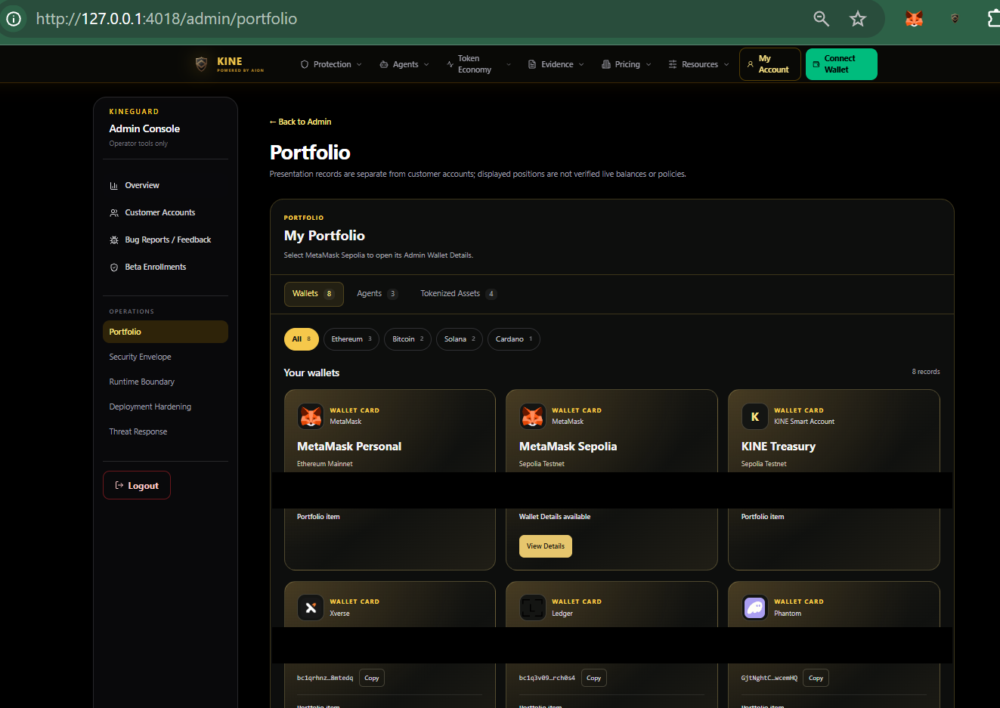

# Protección / Guardian

[ES](../../../../docs/es/menus/protection/guardian.md) · [EN](../../../../docs/en/menus/protection/guardian.md) · [Index](../../index.md)

**Ruta:** [/guardian](https://kineguard.com/guardian) · **Tipo:** página

## 1. Propósito

Supervisa qué necesita atención en las wallets: postura, alertas, aprobaciones y evidencia.

## 2. Cómo lo usa el usuario

1. Abre Guardian y observa los estados Available now, Partial in beta y la procedencia de las tarjetas.
2. Verifica si la vista muestra perfiles de demostración o tu sesión real; no confundas los 3 demo profiles con usuarios.
3. Prioriza alertas, revisa wallet health, approvals o agente relacionado y sigue los enlaces a History.
4. Comprueba source y receipt antes de atribuir un resultado a una wallet.

## 3. Qué mecanismo representa

La ruta pertenece a la familia Protección y debe relacionarse con identidad, política, request exacto y fuente de evidencia.

## 4. Evidencia y límites

Guardian como producto/plan no es Safety Authority, y no otorga veto on-chain ni seguro de fondos.

La visibilidad de una pantalla pública no equivale a aceptación humana de runtime ni a protección universal de fondos.

## 5. Imagen relacionada

*Captura auténtica del KINEGuard local relacionada con el tema; no es una captura certificada de esta URL en Hostinger.*

## 6. Fuentes

- [Public UI](https://kineguard.com/guardian)
- [KINEGuard master protocol](https://app.notion.com/p/41bd5f4fa5e3814e948bf911dddef7ef)
- [Arquitectura](../../architecture.md)
- [Pruebas históricas](../../historical-proofs.md)

[← Volver al menú](index.md)
